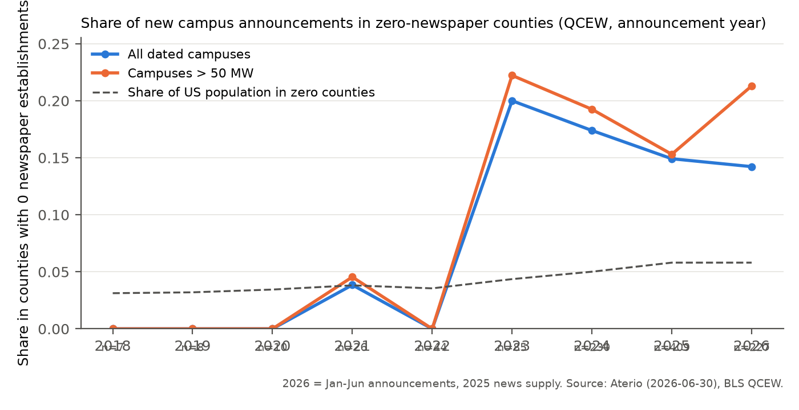
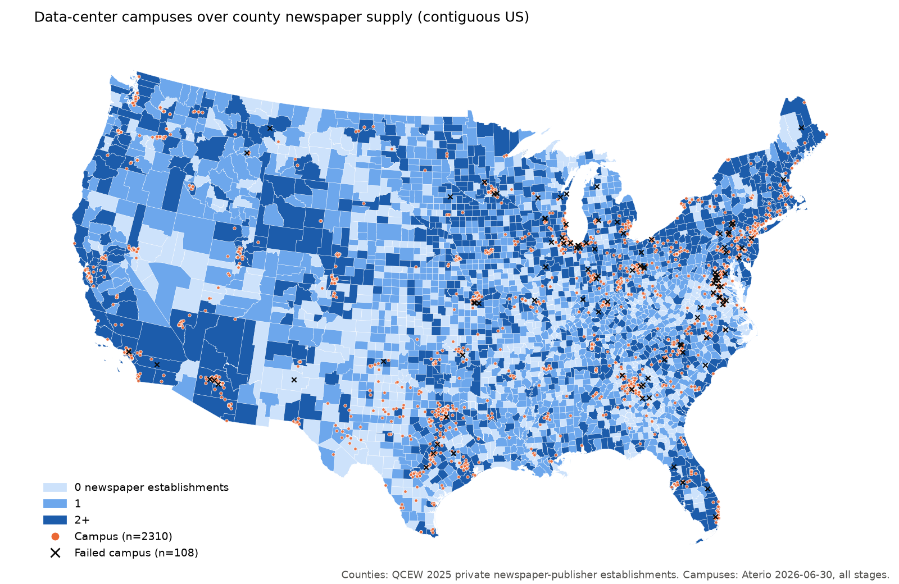
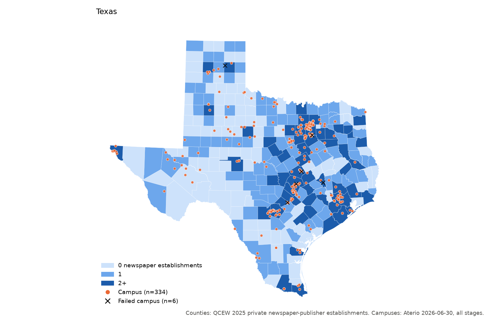
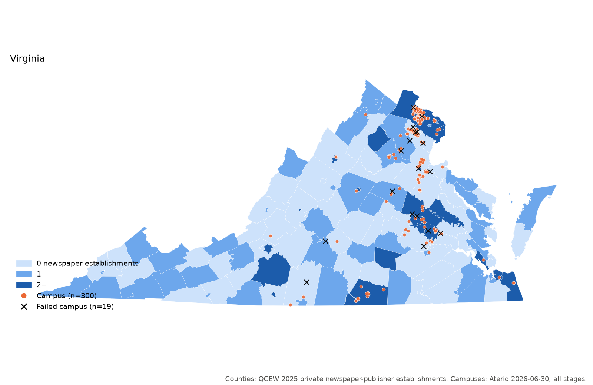
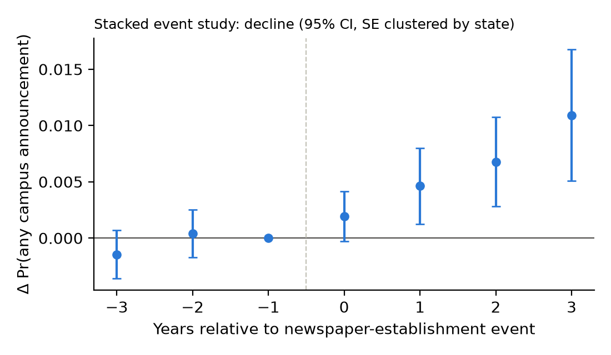

<!-- Built by code/50_build_memo.py from memo/memo_template.md. Every {{tab:...}} below is inserted
verbatim from output/tables/. Numbers quoted in the text come from output/tables or output/logs; the
source file is given in brackets. -->

**Scope.** This memo reports feasibility diagnostics only. All results are correlational: "is associated with" throughout. Nothing here estimates a causal effect.

**Status of this version.** Grid-infrastructure controls are included: county substations ≥230 kV, km of ≥345 kV lines, and project distance to the nearest ≥230 kV substation. Transmission lines come from Esri's archived copy of HIFLD (last updated 2024-09-30); substations come from OpenStreetMap (pulled 2026-11-03), because the HIFLD substation layer is no longer public. About 22% of OSM substations (16,502 of 73,404) have no voltage tag, so ≥230 kV counts are a lower bound [`output/logs/30_pull_grid_infra.txt`]. Project distances above 500 km (AK/HI campuses) are set to missing. Adding grid left every conclusion unchanged relative to the earlier no-grid build; the coefficients that moved are noted where they appear.

# 1. Bottom line

**Does the project have legs on these data?** *Only if* project-level exposure and outcome measures are added. On public county-level news-supply counts plus Aterio alone, the answer is **no** for the closure design and close to no for the cross-sectional sorting design.

- **Design A (newspaper closures as shocks) is not powered.**
  - **Closure events by definition.**

    | Event | Campuses | Counties | Failed campuses among them |
    |---|---|---|---|
    | Any newspaper-establishment decline within ±3 years (QCEW) | 635 of 1,066 dated (60%) | 240 | — |
    | 1→0 transition (county loses its last newspaper) within ±3 years | 61 | 28 | 7 |

    [`a3_overlap_totals`, `a3_outcome_cells`]
  - **Why the large numbers mislead.** The 635 figure is mostly routine attrition in the large counties where campuses sit, not desert formation. Nationally, the median decline event happens in a county with 3 establishments the year before, and the 90th percentile in one with 16 [`a2_decline_event_prior_level`].
  - **The 1→0 event study.** It has only 23 treated county-years with any announcement, so it was not estimated [`43_extensive.txt`].
- **The single biggest obstacle is measurement on both sides of the regression.**
  - **The news measure.** Public newspaper counts are establishment counts, not newsroom capacity or coverage. Census CBP has censored the cells that matter since 2017: county cells with <3 establishments are not published.
  - **The outcome.** Aterio's outcomes are snapshot stage codes, not local decisions. Dated projects are overwhelmingly 2023–26 (951 of 1,066 dated campuses announced 2010+, 89%), and only 87 dated campuses have failed.
- **What the diagnostics show.**
  - **News deserts differ sharply from other counties.** Zero-newspaper counties have about a tenth the population of 2+ counties (mean 23,487 vs 250,731), are far more rural (mean RUCC 6.2 vs 3.8), and have land worth less than half as much [`b3_balance_all_counties`].
  - **Raw associations do not survive comparison within states.** Associations between news supply and announcements are strong in raw data, mostly vanish with state×year fixed effects, and behave like the warehousing placebo.
  - **The one robust within-county association runs the wrong way for the hypothesis.** It is in the any-announcement LPM with county + state×year FE, and survives dropping VA and/or TX. *More* newspapers per capita, and *not* being a zero-newspaper county, go with *more* announcements.
  - **Failure.** It is not associated with news supply in any specification.
  - **Secrecy (P3).** Undisclosed developers are, if anything, slightly *more* common where news is thin, and the association is not robust.

# 2. Data built

## 2.1 Sources pulled

| Source | What | Coverage / vintage | Known problems |
|---|---|---|---|
| Aterio inventory (licensed) | 7,544 facilities (7,132 US) → 2,425 US campuses | snapshot 2026-06-30; second snapshot 2026-02-09 (12 fields) | 30% of facilities lack announced date; record-creation dates start 2024-07-01 |
| **BLS QCEW** (primary news measure) | private establishments, NAICS 511110 (to 2021) / 513110 (2022+), county × year | 2005–2025 | 2021→22 series break (513110 adds internet newspaper publishers); employment suppressed in 85–90% of county cells |
| Census CBP | NAICS 511110 county establishments/employment | 2005–2023 | **from 2017 cells with <3 establishments are not published**; still coded 511110 in 2022–23 |
| Census PEP | county population | 2005–2025 | CT planning regions from 2020s vintages (crosswalked) |
| ACS 2017–21 5-yr | population, income, age, education, race | cross-section | bulk summary file (Census API now needs a key) |
| USDA ERS | RUCC 2023, UIC 2024 (RUCC/UIC 2013 for CT legacy counties) | cross-section | |
| Presidential returns | R share 2016/2020/2024 | MEDSL GitHub 2000–16; unofficial compilation for 2020/2024 | official MEDSL Dataverse file needs a guestbook form; AK only statewide |
| Census of Governments 2022 | general-purpose governments per county | cross-section (CT from 2017) | national counts match published totals exactly |
| USDA NASS (bulk) | ag land value $/acre, Census of Agriculture 2012/17/22 | 3,071 of 3,143 counties | VA independent cities, AK missing |
| EIA-861 | utility C&I prices; county via service territory | 2019–2025 | county-name match 99.9%; Aterio utility-code match 90.4% |
| WRI Aqueduct 4.0 | baseline water stress (project + county) | 2023 release | |
| FCC CDBS | full-power TV/AM/FM by community of license | frozen 2024-01-09 | LMS (current) blocked to scripts |
| FCC Form 477 | broadband (collected; not used in regressions) | June 2021 | National Broadband Map blocked to scripts |
| LoC Directory of US Newspapers | titles with start/end years | partial: 2000+ national subset + all TX/VA | end years rarely updated (below) |
| Data Center Watch | 16-project list from free report | 2023–Q1 2025 | later lists are paid |
| Medill State of Local News 2025 | national totals only | report PDF | no state/county table published |
| Grid (HIFLD lines via Esri archive + OSM substations) | county ≥230 kV substations, km ≥345 kV lines, project distance to ≥230 kV substation | lines 2024-09-30; OSM 2026-11-03 | HIFLD substations not public anymore; 22% of OSM substations lack voltage (≥230 kV counts are a lower bound) |

All raw files are saved untouched under `data/raw/<source>/`, each with a `SOURCE.md`. Data live in Dropbox (`~/Library/CloudStorage/Dropbox/data-centers-newspaper/data`).

## 2.2 Why QCEW, not CBP, is the primary news measure

The brief planned CBP as the backbone. The CBP files themselves show it cannot play that role after 2016 [`cbp_published_cells_by_year`]:

{{tab:cbp_published_cells_by_year}}

- **What breaks.** Through 2016 the minimum published establishment count is 1. From 2017 it is 3, and county cells with a 511110 row fall from 2,588 to 669. A county without a row in 2017+ may have 0, 1 or 2 newspaper establishments, so the CBP zero flag, 1→0 transitions and per-capita counts are unusable after 2016.
- **What QCEW provides instead.** It publishes the establishment count for every county-industry cell, suppressing only employment and wages. It also runs to 2025, which covers the 2024–25 announcement surge.
- **How the two compare.** In 2005–2016 they correlate at 0.95 across county-years. QCEW finds slightly fewer zero counties because it counts UI-covered worksites [`news_qcew_vs_cbp_agreement`].
- **How CBP is kept.** It is retained as `c_*` variables: exact counts through 2016, and a "≥3 establishments" indicator that is consistent across all years.

{{tab:qcew_panel_summary_by_year}}

## 2.3 Geography

Everything is on the **2020 county universe**: 3,143 counties for the 50 states + DC, with Connecticut's 8 legacy counties [`code/geo.py`].

- **Renames.** 02270→02158, 46113→46102, 51515→51019 and 02201→02198 are mapped one-to-one.
- **Splits.** Valdez-Cordova, Skagway-Hoonah-Angoon and Wrangell-Petersburg are allocated by 2020 population.
- **Connecticut planning regions.** These are used by PEP 2020s vintages, CBP 2022–23, QCEW 2024–25, RUCC 2023, CoG 2022 and ACS 2022+. They are allocated to legacy counties with Census's town-level crosswalk and 2020 town populations; every town nests in one region and one legacy county.
  - CBP for CT in 2022–23 is set to missing, because the <3 censoring is defined at region level.
  - QCEW CT changes for 2023→24 are set to missing.
  - Sources that ship both CT geographies keep the legacy rows only.

## 2.4 Aterio: unit of analysis and merges

**Campus rule** [`code/05_build_aterio_campus.py`]:

- **Campus ID.** The campus is `ATERIO_DATA_CENTER_CAMPUS_UID`; the 1,425 US facilities with no campus UID are their own campus.
- **Location and dates.** Announcement date is the earliest building's. County, coordinates, utility and BA are those of the earliest-announced building.
- **Size and flags.** MW is the sum of `SELECTED_POWER_CAPACITY_MW`. AI and BTM equal 1 if any building is flagged.
- **Failure.** `failed` = all buildings Not Approved/Withdrawn or Cancelled. The "any building" version differs for 1 campus.

{{tab:aterio_facility_vs_campus}}

**Stage values are not those listed in the brief.** The file has Announcement, Active, Construction, Not Approved/Withdrawn, Delayed, Land Bank and Cancelled; there is no "Announcement of Development".

{{tab:aterio_stage_counts_facility}}

**County assignment.**

- **Method.** Point-in-polygon on Aterio's lat/lon assigns 7,129 of 7,132 US facilities; one more uses Aterio's own FIPS, and 2 have no location.
- **Agreement with Aterio's FIPS.** The two agree for 93.7% of facilities (443 disagree), and 95% of disagreements are adjacent counties.
- **Spot checks cut both ways.** In Storey County, NV (Tahoe-Reno Industrial Center) the coordinates are right. For a "Casper, WY" record the coordinates sit in Cheyenne.
- **Choice.** Point-in-polygon is primary, and Aterio's FIPS is carried as `fips_aterio` (68 dated campuses in the D sample differ) [`05_build_aterio_campus.txt`, `44_intensive.txt`].

**Merge diagnostics.**

| Step | In | Matched | Dropped / note |
|---|---|---|---|
| US facilities → campuses | 7,132 | 2,425 campuses | — |
| campuses with county | 2,425 | 2,423 | 2 no coordinates/FIPS |
| campuses with announced date | 2,425 | 1,068 | 1,357 undated (mostly Active) |
| dated campuses with QCEW news in announcement year | 1,068 | 1,065 | 2 no county, 1 announced 2002 (pre-2005) |
| 2026 announcements | 227 | use 2025 news | flagged `news_year_lagged` |
| D sample after county controls | 1,065 | 1,049 | 16 missing controls |
| Feb-2026 snapshot UIDs | 5,870 | 5,767 in June | 103 dropped by June; 1,365 June facilities new since Feb |
| EIA utility code → EIA-861 | facilities with code | 90.4% | [`progress.md`, 31_pull_eia861] |
| Data Center Watch 16 projects → Aterio | 16 | 10 | 6 unmatched (name/place) |

## 2.5 Failed or partial sources

From `logs/data_failures.md`:

| Source | Problem | What was done |
|---|---|---|
| Census API | keyless requests now refused | bulk files (CBP, ACS SF, PEP) |
| CBP 2017+ | <3-establishment cells not published | QCEW primary |
| CBP ZBP (place level) | 2023 detail has only 243 ZIP×511110 cells, all ≥3 | **place-level news supply not constructible** |
| USDA NASS API | needs key | keyless bulk `qs.economics` file |
| MEDSL Dataverse | guestbook form required | MEDSL GitHub 2000–16 + unofficial 2020/24 compilation |
| MEDSL 2024 precincts | state totals did not reconcile | used for CT only |
| FCC LMS / Broadband Map | 403 to scripts | CDBS (2024-01) / Form 477 (2021) |
| LoC directory | full pull ≈4 h; one national page failed after retries | 2000+ national subset (may miss up to one page of records) + TX + VA |
| GDELT (BigQuery) | `bq` not installed | not attempted |
| Data Center Watch | no free list after Q1 2025 | 16-project report list |
| HIFLD substations | no public service | OSM Overpass substations; HIFLD lines from Esri archive |

# 3. Measurement findings

## A1. Validity against Medill

{{tab:a1_validity_vs_medill}}

**QCEW flags 816 zero-establishment counties in 2025, nearly four times Medill's 212 news deserts.** It counts 1,267 counties with exactly one establishment, against Medill's 1,525 one-source counties.

**Where the two concepts diverge:**

- **Unit.** A QCEW/CBP "establishment" is a UI-reporting worksite classified as a newspaper publisher. A chain paper printed, edited and reported from a neighbouring county's office is an establishment there, not in the county it covers. Medill counts *titles and outlets serving* a county, including weeklies run by tiny or non-employer operations that never appear in establishment data.
- **Scope.** Medill also counts public broadcasters, digital sites and ethnic media; 513110 contains some digital-only newspapers only from 2022.
- **Coverage.** Establishments with no employees (sole proprietors) are not in QCEW or CBP at all.
- **Rurality.** The direction of the gap is as expected: the establishment measure over-calls deserts in small rural counties. 72% of QCEW zero counties are nonmetro, versus Medill's "almost 80%" of news deserts being predominantly rural.
- **Broadcast.** Of the 816 QCEW-zero counties, 58 have a full-power TV station licensed to a community there and 609 have a full-power radio station [FCC CDBS].
- **State comparison.** It is not possible: Medill publishes no state table, and its maps are images. QCEW zero counties by state are in [`a1_qcew_zero_by_state_2025`]; TX (97), GA (75) and VA (64) lead.

## A2. Closure events

{{tab:a2_closure_events_by_year}}

{{tab:a2_closure_events_by_rurality}}

- **Declines are common.** QCEW shows 223–364 county-year declines per year.
- **Full exits are rarer and rising.** 1→0 transitions run 17–95 a year and have risen sharply since 2020: 81 in 2023, 95 in 2024, 82 in 2025.
- **Rurality.** Declines concentrate in metros (3.1 per county over 2006–25 vs 0.9 in RUCC 8–9), but 1→0 exits are most frequent in the most rural counties (0.34 per county).
- **The 2022 dip** in declines (223) coincides with the NAICS change, which added establishments.

## A3. Overlap and power (Design A)

{{tab:a3_overlap_totals}}

{{tab:a3_overlap_by_year}}

{{tab:a3_overlap_by_stage}}

{{tab:a3_outcome_cells}}

- **Read the decline numbers as attrition, not desert shocks.** A ±3-year "decline" around a dated campus is the norm (60% of campuses), because campuses are in large counties where some establishment closes most years.
- **The desert-relevant event, 1→0, overlaps 61 campuses (5.7%) in 28 counties, of which 7 failed.**
- **Window truncation.** For 2024–26 announcements the window is right-truncated (QCEW ends 2025). The pre-only window (−3..0) gives 54 campuses.
- **CBP cannot contribute.** With exact counts only through 2016, it overlaps 36 dated campuses in total.
- **Conclusion.** A closures-as-shocks design with failure as the outcome would rest on about 7 treated failures. **It is not feasible with these data.**

## A4. Detection bias in Aterio

- **What the record-creation date can measure.** `RECORD_CREATED_DATE` begins on 2024-07-01, so for earlier announcements the "detection lag" is mechanically time-until-database-inception (median 18 months). The informative sample is the 765 dated campuses announced on or after 2024-07-01. Their median lag is 0.26 months, and the 75th percentile is 1.8 months [`a4_detect_lag_describe`].

{{tab:a4_detect_lag_regressions}}

- **Detection lag.** In the post-inception sample, lag is not associated with news supply. Coefficients are under ±0.6 months and insignificant with and without controls and state + month FE.
- **The full-sample q_zero coefficient (−3.5 months).** It is significant only without FE. It reflects the pre-inception mechanics (zero-news projects are newer), and it disappears with announcement-month FE.

{{tab:a4_missingness_by_news_group_2025}}

- **Missingness by news group.**
  - **Announced dates.** Campuses in 2+ counties are much *more* likely to lack an announced date (64% vs 27% in zero counties). This is because the undated stock is old, active metro data centers.
  - **Undisclosed providers and permit URLs.** Undisclosed providers are more common in zero/one counties (22–23% vs 10%), and permit URLs are more often present there (36% vs 18%).
  - **Interpretation.** These gaps are compositional (vintage, project type), not an obvious detection gradient.

{{tab:a4_failed_share_dated_by_group}}

{{tab:a4_late_added_by_quartile}}

- **Failed projects are not under-represented in low-news counties.** Among dated campuses the failed share is 10.6% in zero counties vs 8.2% in 2+ counties. Counted per 100 active campuses the gap is huge (41 vs 6), but that compares a recent flow to an old stock and is not informative [`a4_failed_vs_active_by_group`].
- **Late-added records.** Of the June-2026 facilities absent from the Feb-2026 snapshot, 456 were announced before 2026. Their share is *lowest* in the lowest-news quartile (6.9%) and highest in quartiles 3–4 (15–17%).
- **What this implies.**
  - **What it does not show.** There is no sign that Aterio detects projects later, or misses failures, in low-news counties, so detection does not obviously bias C–E toward finding a low-news association.
  - **What it cannot rule out.** Projects never detected at all are, by construction, unobservable here.
  - **Where Aterio finds projects.** Aterio's datasheet links show it relies heavily on company sites and government records, not only news: 25% of facilities cite at least one local-news URL, 37% a company site and 18% a government/agency page [`aterio_links_datasheet_type_shares`]. That plausibly explains the absence of a detection gradient.

## A5. Stage coding and outcome definitions

{{tab:a5_stage_vs_dates_facility}}

- **Withdrawn records.** Of 552 Not Approved/Withdrawn facilities, 512 have only a withdrawn date, 5 only a cancel date, 5 both, and **30 neither**.
- **Cancelled records.** Of the 19 Cancelled facilities, 1 has no cancel date.
- **Other stages.** No other stage carries cancel or withdraw dates, so the coding is internally consistent apart from these 31 date gaps. `failed` therefore uses the stage, not the dates.

{{tab:a5_announce_to_construction_lag_facility}}

**Defining "stalled".**

- **Choice of X.** Among buildings with both dates (construction start on or before the snapshot), announcement-to-construction-start has a median of 10.1 months, a 75th percentile of 20.3 and an 80th of 23.0. **X = 24 months** is therefore the point by which about 80% of projects that do break ground have done so.
- **Definition.** `stalled_X` = not failed, campus stage in {Announcement, Delayed, Land Bank}, no construction start by 2026-06-30, and announced more than X months before the snapshot.
- **Coverage.** It is defined only for campuses old enough to be eligible. Delayed is included as stalled. Robustness thresholds are X = 12, 18 and 36.

{{tab:a5_outcome_definitions_campus}}

**Power on stalled is weak.** Only 300 campuses are old enough for X = 24, and 145 for X = 36.

# 4. Descriptives

## B3. Balance table (the confounding problem)

All 3,143 counties by 2025 QCEW newspaper-establishment group:

{{tab:b3_balance_all_counties}}

Counties hosting at least one campus announced 2022+:

{{tab:b3_balance_host_counties}}

- **News supply is a proxy for county size and rurality.** Zero-newspaper counties are about one-tenth the population of 2+ counties, much more rural, poorer, more Republican and cheaper (land $4,217 vs $10,130 per acre). They have more governments per capita and almost no broadcast stations.
- **Within host counties.** The gap persists, but zero-newspaper hosts are much less rural than zero-newspaper counties generally (61% metro). Data centers that land in "news deserts" land in exurban deserts.
- **Industrial power.** It is cheaper in zero counties (9.2 vs 10.3 c/kWh), as is land.
- **Implication.** Any cross-sectional association between news supply and siting is confounded by exactly the fundamentals that drive siting.

## B1–B2. Projects

{{tab:b1_campuses_by_year_stage}}

{{tab:b1_campuses_by_mwbin_stage}}

By news supply in the announcement year (QCEW):

{{tab:b2_campuses_by_news_group}}

{{tab:b2_campuses_by_news_quartile}}

- **Projects in zero-newspaper counties are bigger and more AI/BTM-heavy.**
  - Median 351 MW vs 196 MW in 2+ counties.
  - 93% are above 50 MW.
  - 29% have the AI flag (vs 22%) and 16% the BTM flag (vs 9%).
  - They are more often undisclosed: 29% vs 24%.
- **They fail somewhat more often:** 10.5% vs 8.2% of dated campuses.
- **Per-capita quartiles.** These are dominated by county size. The large metro hosts (Loudoun, Maricopa, Dallas) have few newspapers *per capita* and fall in quartile 2, so the quartile measure does not order counties by news supply in the way the 0/1/2+ grouping does.

{{tab:b4_share_announcements_zero_counties}}

- **The share of announcements landing in zero-newspaper counties rose** from near 0 in 2017–2022 (n ≤ 44 per year) to 14–20% in 2023–26.
- **It still sits well below the share of counties that are zero (26% in 2025).**
- **It sits well above the share of population living in them (5.8%).**
- **Counts before 2021 are tiny** (n ≤ 10 per year).

# 5. Regression results

**Notation.** $N_{c,t-1}$ is news supply in county $c$, lagged one year: either `q_pc10k` (QCEW newspaper establishments per 10,000 residents) or `q_zero` (no establishment).

- **County panel (C).**
  $$E[A_{ct}\mid\cdot]=\exp\big(\beta N_{c,t-1}+X_c'\gamma+\alpha_c+\delta_{s(c)t}\big)$$
  estimated by PPML for counts, and as an LPM for $1[A_{ct}>0]$. SEs are **clustered by state**.
- **Campus level (D, E).**
  $$Y_i=\beta N_{c(i),t(i)}+Z_i'\theta+X_{c(i)}'\gamma+\delta_{s\times t}+\varepsilon_i$$
  estimated as an LPM, with SEs **clustered by county**.
- **Columns.**
  1. bivariate
  2. demographics + RUCC (+ year FE in C)
  3. siting fundamentals (grid, land value, industrial price, water stress)
  4. state×year FE
  5. C: county FE + state×year FE; D/E: balancing-authority×year FE
- **Coefficient units.** `q_pc10k` coefficients are per one establishment per 10k residents; its 2025 interquartile range across counties is roughly 0.24–0.65.

## C. Extensive margin (county × year, 2010–2026)

- **Panel.** It has 53,431 county-years. 2,674 of 3,143 counties (85%) never have an announcement, and only 716 county-years have one [`43_extensive.txt`].
- **Common sample.** Excluding counties with missing controls leaves 51,663 county-years in 3,039 counties.
- **PPML drops.** PPML drops all-zero groups: N falls to 15,714 with state×year FE and to 2,953 with county FE (the 458 announcing counties' county-years in announcing state-years).

**Announcements (count, PPML):**

{{tab:c_n_ann_q_pc10k_l1}}

{{tab:c_n_ann_q_zero_l1}}

**Any announcement (LPM):**

{{tab:c_any_ann_q_pc10k_l1}}

{{tab:c_any_ann_q_zero_l1}}

**MW announced (PPML):**

{{tab:c_mw_ann_q_pc10k_l1}}

{{tab:c_mw_ann_q_zero_l1}}

**What the pattern shows.**

- **Bivariate.** Counties with more newspapers per capita get *fewer* announcements (PPML −2.16). That is the size/rurality composition: per-capita news is high in small rural counties.
- **With controls.** Demographics and RUCC cut the PPML coefficient by 80%, and with state×year FE it is −0.11 (se 0.15).
- **The LPM flips sign.** With state×year FE, and more so with county FE (C5: +0.0030, se 0.0011), more news per capita goes with a higher probability of any announcement. Becoming a zero-newspaper county goes with a 0.9 pp *lower* probability (C5: −0.0091, se 0.0043).
- **Against the baseline.** Mean any-announcement probability is 716/53,431 ≈ 1.3%, so these are not small relative to the mean.
- **The other outcomes in C5.** PPML counts are null. MW announced is positive and significant at 5% for `q_pc10k` (+0.32, se 0.16) and negative, significant only at 10%, for `q_zero` (−0.61, se 0.32).

**What it does not show.**

- **It does not support the extensive-margin sorting hypothesis on these data.** The within-county associations run the opposite way.
- **Where C5 identification comes from.** It rests on 66 announcing counties whose zero status switches and on small per-capita changes (median within-county SD 0.048 among announcing counties) [`c5_within_county_variation`].
- **Per-capita changes are partly mechanical.** A growing county's per-capita count falls even with a constant number of papers. Population growth attracts data centers, which would push the coefficient negative; the C5 sign is positive despite this.
- **The QCEW 2022 code change** also moves within-county counts and is only partly absorbed by state×year FE.

**Heterogeneity** (PPML, stacked type panels; interaction = difference for the type):

{{tab:c_heterogeneity}}

- **Size, AI and BTM.** With state×year FE, the negative association of news supply with announcements is concentrated in projects ≤50 MW. The interaction for >50 MW (+0.85) offsets it, and BTM projects show a similar positive interaction (+0.69; also +0.40 with county FE).
- **Post-2021 (P4).** The coefficient differs (`q_pc10k`: −1.38 pre, +1.32 interaction with state×year FE), but this is identified off very few pre-2022 announcements, and the interaction is insignificant at 5%.
- **One cell failed to converge.** The q_zero × 50+ MW cell with county FE (PPML separation) is marked `[suspect]` / `SUSPECT` and should be ignored.
- **The predicted sign is absent.** None of this shows sorting into low-news places becoming *stronger* after the AI boom.

**Event study (C6).**

- **Design.** The stack is built around a county's first decline in QCEW newspaper establishments in cohort years 2008–2023. Controls are counties in the same state and same lagged size band with no decline in the window. Outcome = any announcement; reference period k = −1.

{{tab:c6_event_cohorts_decline}}

{{tab:c6_event_study_decline}}

- **Column key.** `trt_cy_ann` = treated county-years with an announcement; `trt_cty_ann` = treated counties with any announcement in the window.
- **Data.** There are 145 treated county-years with an announcement, almost all in the 2021–23 cohorts.
- **Pre-trends.** They are flat: k = −3: −0.0015 (se 0.0011); k = −2: +0.0004.
- **Post-event.** Coefficients rise steadily to +0.011 at k = +3 (se 0.003).
- **Interpretation.**
  - **Why not as a deterrence or sorting effect.** Treated counties are those large enough to lose an establishment, and the post periods of the 2021–23 cohorts are the AI-boom years. Size-band matching (0–1 / 2 / 3–5 / 6+) does not equalize Loudoun with a 6-paper rural county.
  - **What it shows.** Declines happen where data-center growth happens. Nothing here isolates the news channel.
- **1→0 version.** It was not estimated: only 23 treated county-years have an announcement [`c6_event_cohorts_1to0`].

## D. Intensive margin (campus level)

- **Sample.** It has 1,049 dated campuses with controls. 87 failed, and 299 are eligible for `stalled_24` (72 stalled).
- **Controls.** Project controls are log MW (with missing flag), AI, BTM, and provider public. County and siting controls are demographics, RUCC, county grid (substations ≥230 kV, km ≥345 kV lines), land value, county industrial price, water stress, project distance to a ≥230 kV substation, project water stress and the utility industrial price (missing-indicator method).
- **SEs** are clustered by county.

**Failed:**

{{tab:d_failed_q_pc10k}}

{{tab:d_failed_q_zero}}

**Stalled (X = 24):**

{{tab:d_stalled_24_q_pc10k}}

{{tab:d_stalled_24_q_zero}}

- **Failure.** Failure is not associated with either news measure in any column.
  - Point estimates are stable: −0.02 to −0.04 for `q_pc10k`, +0.02 to +0.03 for `q_zero`.
  - Precision is poor: with 87 failures, the zero-county coefficient's 95% CI spans roughly −4 to +10 pp, against a failed share of 8.2% in 2+ counties.
  - The signs are the *opposite* of "more news → more failures".
- **Stalled.**
  - **Unstable across thresholds.** `q_pc10k` is insignificant in every column at X = 24 (largest +0.37, se 0.33, with state×year FE; it was +0.51, se 0.25, p = 0.046, before grid controls were added). `q_zero` is positive at X = 12 (about +0.15 to +0.21, significant), insignificant at X = 24 and X = 36, and `q_pc10k` is strongly negative at X = 36 (−1.17, se 0.50, with state×year FE; 88 campuses).
  - **No consistent sign** emerges across thresholds [`d_robustness_outcomes_coef`, `d_all_long`].

{{tab:d_cox_time_to_construction}}

**Time to construction start (Cox).**

- **Result.** Zero-newspaper hosts are associated with *slower* starts (HR 0.67, p = 0.02 with controls). That matches the stall pattern at X = 12.
- **Caveats.** Construction starts are observed for only 348 campuses, Cox SEs are not clustered, and there are no state×year FE.

**Place level.** This is not possible. QCEW has no place or ZIP detail, and CBP ZIP files censor <3 cells the same way (243 published ZIP×511110 cells nationally in 2023).

**Within-county.**

{{tab:d_within_county_counts}}

{{tab:d_within_county_regressions}}

- **Usable counties.** There are 139 counties with dated campuses in at least two different years. 93 have any within-county change in per-capita news, which is mostly population-driven, and only 3 switch zero status.
- **Result.** All estimates are null and uninformative.

## E. Secrecy test (P3)

- **Variant check.** "Company Not Disclosed" is the only non-disclosure variant in `PROVIDER_NAME`, after searching for disclos/unknown/confidential/unnamed/TBD/stealth patterns. It covers 1,349 US facilities (18.9%).
- **Sample.** Dated campuses: 25.0% undisclosed and 91.6% with no listed end user.

{{tab:e_undisclosed_q_pc10k}}

{{tab:e_undisclosed_q_zero}}

{{tab:e_no_end_user_q_pc10k}}

- **Result.** P3 predicts undisclosed developers are relatively *more* common where news is strong. The estimates point the other way, and weakly.
  - `q_pc10k` is negative in all columns (−0.04 to −0.09), significant only in column 3 and only at 10% (−0.088, se 0.047, p = 0.06).
  - `q_zero` is positive (+0.05 to +0.08), never significant.
- **All-campus sample.** It uses 2025 news and gives the same sign [`e_all_long`].

**Is "undisclosed" developer secrecy or Aterio ignorance?**

{{tab:e_resolution_feb_to_jun}}

{{tab:e_resolution_by_group}}

- **Resolution.** Between Feb and Jun 2026, 331 of 1,329 undisclosed facilities (25%) gained a named provider, and none went the other way. Resolution rates are similar across news groups (27% zero, 25% one, 24% 2+).
- **What resolution looks like.** Disclosure often happens as projects advance, consistent with real developer secrecy (NDAs, code names) that later lifts. That is not proof.
- **Detection lag.** Undisclosed status is not associated with it (coef 0.13 months, se 0.33) [`e_detect_lag_regression`].
- **Undated campuses.** Undisclosed campuses are rarely undated (12% vs 62%), because they are recent announcements.

{{tab:e_undisclosed_by_state|cols=state,campuses,undisclosed_n,undisclosed_share}}

**State differences are large.** PA (39%), GA (33%) and NY (16%) have high undisclosed shares; WA (2%), OR (4%) and CA (5%) have low ones. State norms on NDAs and public records plausibly dominate, which column 4 absorbs.

## F. Placebos and leave-one-state-out

**F1. Warehousing (NAICS 493) placebo.** Outcomes are new warehousing establishments: net new (PPML) and any increase (LPM).

{{tab:f1_warehousing_placebo|cols=outcome,regressor,spec,coef,se,p,n}}

- **Cross-sectional associations are shared with warehousing.** In columns 2–4, zero-newspaper counties get significantly fewer new warehouses (PPML −0.31 to −0.61), mirroring the data-center pattern. That suggests the cross-sectional associations reflect rurality and market size rather than scrutiny.
- **The C5 data-center association is not shared.** With county + state×year FE the warehousing coefficients are 0 (−0.007 and −0.011). The data-center LPM coefficients in the same 2010–2025 sample remain (`q_pc10k` +0.0025, se 0.0009; `q_zero` −0.0070, se 0.0037).

**F2. Placebo timing** (news measured 5 years *after*).

- **Panel version.** It is feasible only for outcome years ≤ 2020, which contain 45 announcements in 42 county-years. All coefficients are about 0, as are the real-timing ones in that window [`f2_placebo_timing`], so this placebo has no power.
- **Campus version.** It was not run: 47 campuses were announced ≤ 2020 and none failed.

**F3. Leave-one-state-out.**

{{tab:f3_loso_key}}

{{tab:f3_loso_range}}

- **C5 LPM.** The coefficients keep their sign under every single-state drop. `q_pc10k` is significant at 5% in 49 of 49 drops and `q_zero` in 38 of 49. Dropping VA and TX together leaves them significant (+0.0022, −0.0062).
- **C5 PPML.** It stays null.
- **D4 failure.** It stays null in all drops; dropping TX makes `q_pc10k` −0.12 (se 0.08).

# 6. What these diagnostics cannot tell us

- **Establishment counts ≠ newsroom capacity or coverage of a project.** A county can have one newspaper establishment that never covered the rezoning, or none and be covered by a regional daily or TV station. The relevant treatment, coverage of *this* project before the decision, is not measured anywhere in these data.
- **Aterio outcomes ≠ local decisions.**
  - "Not Approved/Withdrawn" mixes denials, developer withdrawals, utility-capacity failures and financing collapses.
  - There are no hearing dates and no vote records.
  - Stage is a snapshot, so "stalled" conflates slow permitting with shelved projects.
- **Selection into Aterio.**
  - Undetected projects are unobservable.
  - The database began in mid-2024, so pre-2024 failures may be under-recorded.
  - Old active facilities mostly lack announcement dates, so the dated sample is essentially the 2023–26 AI-era cohort.
- **No measure of pre-hearing coverage, and no hearing dates.** The causal story runs through public attention before a decision, and nothing here observes that timing.
- **Thin treatment variation.** Within-county changes in news supply around 2022–26, when nearly all projects occur, are small: 66 announcing counties switch zero status. QCEW's 2022 code change adds measurement noise exactly then.
- **Small outcome counts.** There are 87 dated failures and 72 stalled campuses at 24 months. Confidence intervals on failure effects are wide enough to include meaningful effects of either sign.
- **Grid controls are approximate.** OSM substation voltages are missing for about 22% of substations, and the HIFLD line layer is a 2024 archive; the ≥230 kV line total (300,780 km) looks high relative to published US transmission totals, so line-km is noisy [`output/logs/30_pull_grid_infra.txt`]. Texas delivery-only utilities have no EIA-861 price.
- **Election shares** for 2020/2024 come from an unofficial compilation. Its 2016 cross-check differs from MEDSL by >1 point for about 10% of counties.

# 7. Easy data wins for Daniel

| ✓ | Item | Why it matters | Effort | How |
|---|---|---|---|---|
| ☐ | **Census API key** (free) | lets scripts use the API instead of bulk files; future ACS/CBP vintages | 5 min | api.census.gov/data/key_signup.html; set `CENSUS_API_KEY` |
| ☐ | **USDA NASS QuickStats key** (free) | avoids the 585 MB bulk file; easy yearly updates | 5 min | quickstats.nass.usda.gov/api |
| ☐ | **MEDSL county returns** (guestbook form) | official 2020/2024 vote shares (current ones are unofficial) | 5 min | Dataverse doi:10.7910/DVN/VOQCHQ → save as `data/raw/medsl/countypres_2000-2024.csv`; `22_pull_elections.py` picks it up (that branch is untested) |
| ☐ | **Media Cloud account + API key** (free, registration) | **project-level coverage counts**: articles mentioning each project, developer or code name in local sources before decisions. This is the treatment the brief actually needs | 1 day to set up queries; scale with project names already in Aterio | mediacloud.org; verify current free-tier limits and local-source coverage before relying on it |
| ☐ | **BU library: NewsBank / Access World News, ProQuest** | historical local-paper full text for the same project-level coverage measure; covers small dailies and weeklies Media Cloud may miss | 1–2 days for a TX/VA pilot of ~100 projects | BU Libraries databases; check text-and-data-mining terms before bulk use |
| ☐ | **Editor & Publisher Yearbook** (BU) | title-level counts by place and year: a better news-supply panel than establishments, and the only route to place-level supply | several days to digitize a few states | BU Libraries (print/online holdings) |
| ☐ | **Email Medill Local News Initiative** | their outlet-level database (6,400+ newspapers, plus public broadcasting, digital and ethnic outlets) is described as "proprietary"; county-year outlet counts would replace the establishment proxy and directly match the 212/1,525 counts | 1 email; response uncertain | localnewsinitiative.northwestern.edu; the 2023 site lists a database manager (John Volk) |
| ☐ | **UNC/Abernathy legacy data** | earlier news-desert database (usnewsdeserts.com, 2018) for 2004–2018 closures | check if still online | usnewsdeserts.com, or ask Medill, where the project moved |
| ☐ | **Data Center Watch** | external opposition outcomes; the free list has 16 projects (10 matched to Aterio; 6 of the matched rows are coded withdrawn, and two of those rows are the same Provident campus) | $250 per quarterly "Insights" report | datacenterwatch.org/shop; do not scrape the map |
| ☐ | **Aterio `PROJECT_PERMIT_URL` → hearing dates (Texas pilot)** | the outcome the project needs | about 2–4 days for TX | filled for 35% of facilities / 21% of campuses (TX 31% of campuses; VA 33%). In TX, 228 URLs on 28 campuses point to agenda/minutes systems (destinyhosted, CivicClerk, Granicus, IQM2, Legistar) where hearing dates and votes can be read [`aterio_links_tx_permit_domains`]. Most other TX permit links are TCEQ/TDLR state filings (dated, but not local hearings) |
| ☐ | **Aterio `DATASHEET_URL` local-news links** | free proto-coverage measure: 1,800 facilities (25%) cite at least one local-news article; dates and outlets in these links could be harvested | 1 day | `aterio_links_local_news_domains.csv` lists the 253 domains classified as local news, for a human check |
| ☐ | **Aterio events table** (ask vendor) | the data dictionary describes a "Data Centers Events" product with dated Announcement/Construction/Active/Inactive events; it would give stage *histories* instead of a snapshot | email Aterio | not in the current delivery |
| ☐ | **Keep saving Aterio snapshots** | the Feb→Jun comparison already gave the only evidence on secrecy resolution; monthly snapshots turn the stage snapshot into a panel | none | archive each delivery as done in `VINTAGES.csv` |
| ☐ | **CoreLogic via BU** | housing-side outcomes near projects (as planned) | BU access | not evaluated here |
| ☐ | **FCC LMS** (current broadcast) | CDBS is frozen at 2024-01 | manual download in a browser | enterpriseefiling.fcc.gov LMS public database |

# 8. Recommended next steps

Ordered by value per hour:

1. **Texas (+ Virginia) hearing-date pilot from Aterio permit links.**
   - Hand-collect hearing dates and vote outcomes for the 28 TX campuses with agenda/minutes links, plus VA withdrawn/delayed campuses.
   - This tests whether a decision-level outcome can be built at all; without it the intensive margin has no outcome.
2. **Project-level coverage for the same pilot.**
   - Count local articles before each hearing (Media Cloud first; NewsBank via BU for smaller papers).
   - This replaces the establishment proxy with the actual treatment and shows whether coverage varies enough across projects to be useful.
3. **Request the Medill outlet database**, and check whether the UNC 2004–2018 file is still available. Outlet counts by county-year would fix the 816-vs-212 validity gap and make closure events meaningful.
4. **Archive Aterio snapshots monthly** and ask the vendor about the Events table. Stage histories turn "failed/stalled" into dated transitions and let secrecy resolution be studied properly.
5. **Improve grid controls.** Replace OSM substations with a licensed or utility-filed substation inventory with complete voltages, and add interconnection-queue position; re-run with `code/run_all.sh`.

**Observations** (one line each, not pursued):

- Zero-newspaper hosts get larger, more AI- and BTM-heavy projects.
- Newspaper-establishment declines co-move with data-center growth in larger counties.

# 9. Appendix

## 9.1 Variable dictionary

| Variable | Definition | Source / script |
|---|---|---|
| `q_est` | private newspaper-publisher establishments (QCEW annual average; 511110 ≤2021, 513110 ≥2022) | 02b |
| `q_pc10k` | `q_est` per 10,000 residents (PEP) | 04 |
| `q_zero` | 1 if `q_est` = 0 | 04 |
| `q_grp` | 0 / 1 / 2+ establishments | 04 |
| `q_pcq` | within-year quartile of `q_pc10k`; ties share the lowest rank, so all zero counties are in quartile 1 | 04 |
| `q_decl`, `q_1to0`, `q_0to1` | change vs t−1: decline ≥1; ≥1→0; 0→≥1 (CT 2024 set missing) | 04 |
| `c_est`, `c_zero` | CBP establishments / zero flag, 2005–2016 only | 01b, 04 |
| `c_ge3` | CBP ≥3 establishments (consistent all years; CT 2022–23 missing) | 01b |
| `*_l1`, `*_f5` | value in t−1 / t+5 | 40 |
| `n_ann`, `any_ann`, `mw_ann` | campus announcements in county-year; any; summed MW | 40 |
| `failed` / `failed_any` | all / any campus buildings Not Approved/Withdrawn or Cancelled | 05 |
| `stalled_X` | see A5 | 05 |
| `undisclosed` | campus provider = "Company Not Disclosed" | 05 |
| `no_end_user` | no building lists END_USER_COMPANIES | 05 |
| `detect_lag_m` | months from earliest announced date to earliest record creation | 05 |
| `mw`, `mw50`, `mw_bin` | summed SELECTED_POWER_CAPACITY_MW; >50 MW; Aterio bins | 05 |
| `ai`, `btm` | any building flagged | 05 |
| `log_density`, `log_income`, `sh_65plus`, `sh_ba_plus` | ACS 2017–21 | 20, 40 |
| `rucc`, `metro`, `rural_grp` | RUCC 2023 (CT: 2013); metro = RUCC ≤3; groups 1–3 / 4–7 / 8–9 | 21, 40 |
| `log_land_value` | log NASS 2022 ag land value $/acre | 24, 40 |
| `price_ind_cty`, `price_ind_util` | EIA-861 2025 industrial price, county average / project utility | 31 |
| `bws_raw_cty`, `bws_raw` | Aqueduct 4.0 baseline water stress, county / project | 32 |
| `rep_share_YYYY` | Republican share of total presidential vote | 22, 40 |
| `n_general_purpose`, `govs_per10k` | CoG 2022 county + municipal + township governments | 23, 40 |
| `n_tv_full`, `n_radio_full` | full-power stations licensed to communities in county (CDBS 2024-01) | 11 |

## 9.2 Code map

| Script | Produces |
|---|---|
| `00_profile_aterio.py` | `aterio_*` profile tables; `output/logs/00_profile_aterio.txt` |
| `00b_download_geo_pop.py` | county shapes, CT crosswalk, PEP, Medill PDF |
| `01a/01b_*cbp*.py` | CBP raw + `cbp_county_year`; `cbp_*` tables |
| `02a/02b_*qcew*.py` | QCEW raw + `qcew_county_year`; `qcew_*` tables |
| `03_build_population.py` | `pop_county_year` |
| `04_build_news_panel.py` | `news_county_year`; `news_*` tables |
| `05_build_aterio_campus.py` | campus file; `a5_*` tables |
| `06_overlap_power.py` | `a3_*` tables |
| `10`–`14` | LoC, FCC, GDELT check, Data Center Watch, Aterio link profile (`aterio_links_*`, `dcw_aterio_match`) |
| `20`–`24` | ACS, RUCC/UIC, elections, Census of Governments, NASS |
| `30`–`33` | grid (HIFLD lines, OSM substations), EIA-861, Aqueduct, broadband |
| `40_build_analysis_data.py` | county controls, county-year panel, campus analysis file |
| `41_measurement.py` | `a1_*`, `a2_*`, `a4_*` |
| `42_descriptives.py` | `b1_*`–`b4_*`, figures `b4_*`, `b5_*` |
| `43_extensive.py` | `c_*`, `c5_*`, `c6_*`, figure `c6_*` |
| `44_intensive.py` | `d_*` |
| `45_secrecy.py` | `e_*` |
| `46_placebos.py` | `f1_*`–`f3_*` |
| `50_build_memo.py` | this memo (MD + PDF) |
| `run_all.sh` | runs everything in order |

## 9.3 Additional regression tables

**Robustness outcomes, intensive margin (coefficients):**

{{tab:d_robustness_outcomes_coef}}

**No end user, q_zero:**

{{tab:e_no_end_user_q_zero}}

**Leave-one-state-out, all drops:** `output/tables/f3_loso_all.csv` (not printed; 312 rows).

**Long-format files with formulas and clustering for every regression:** `c_all_long.csv`, `d_all_long.csv`, `e_all_long.csv`, `f1_warehousing_placebo.csv`, `f2_placebo_timing.csv`.
