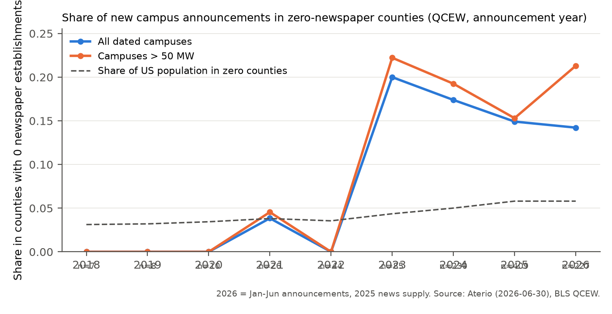
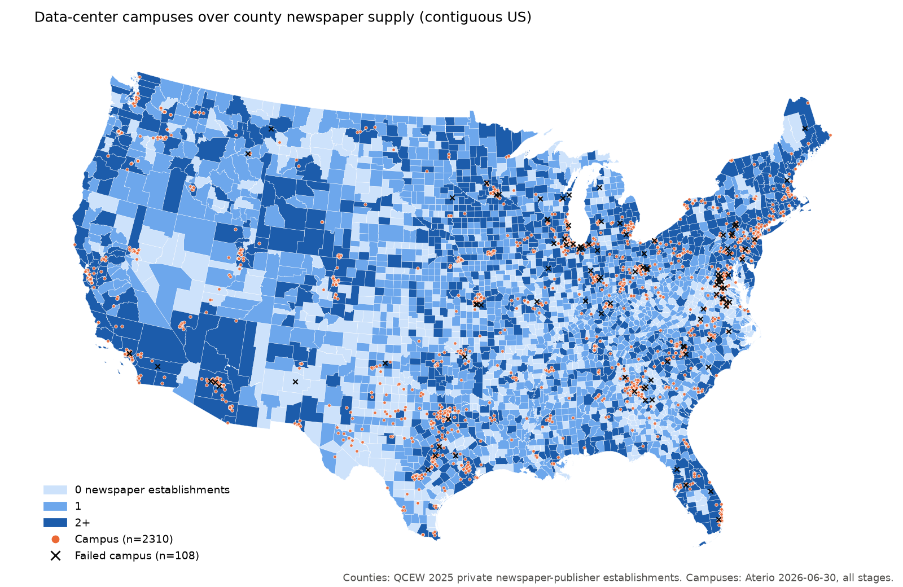
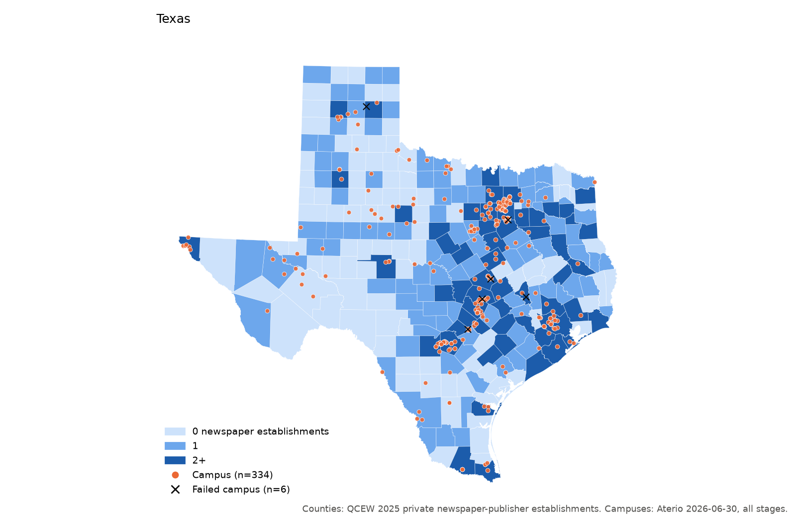
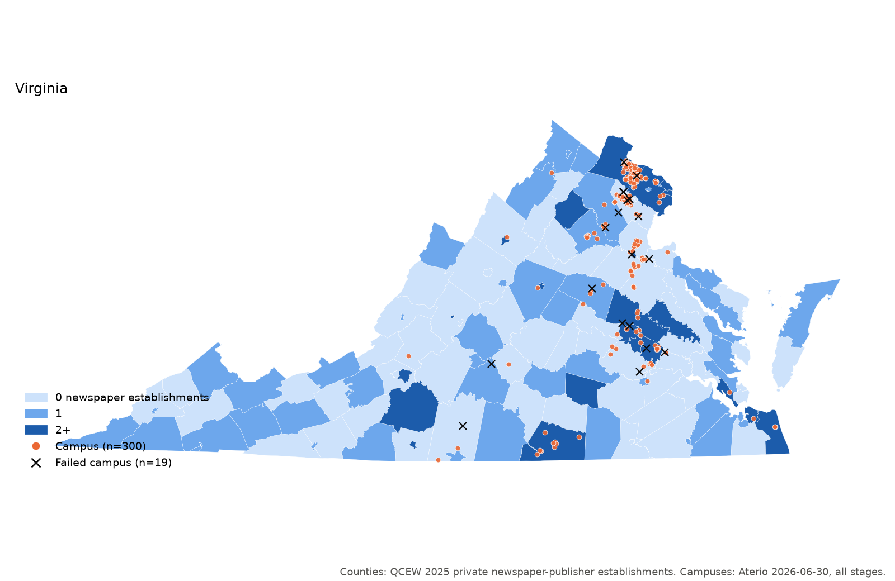
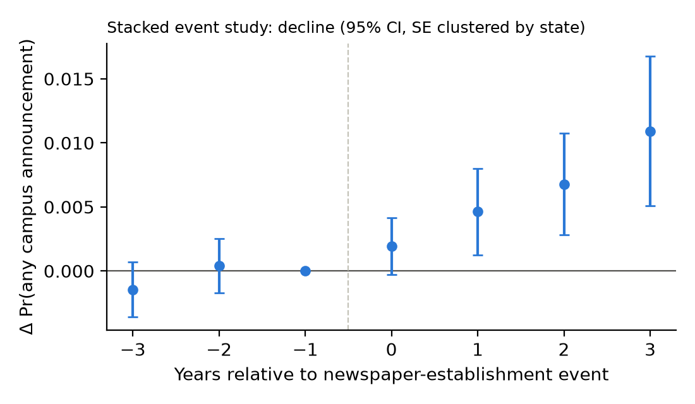

<!-- Built by code/50_build_memo.py from memo/memo_template.md. Every {{tab:...}} below is inserted
verbatim from output/tables/. Numbers quoted in the text come from output/tables or output/logs; the
source file is given in brackets. -->

**Scope.** This memo reports feasibility diagnostics only. All results are correlational: "is associated with" throughout. Nothing here estimates a causal effect.

**Status of this version.** Grid-infrastructure controls are included: county substations ≥230 kV, km of ≥345 kV lines, and project distance to the nearest ≥230 kV substation. Transmission lines come from Esri's archived copy of HIFLD (last updated 2024-09-30); substations come from OpenStreetMap (pulled 2026-11-03), because the HIFLD substation layer is no longer public. About 22% of OSM substations (16,502 of 73,404) have no voltage tag, so ≥230 kV counts are a lower bound [`output/logs/30_pull_grid_infra.txt`]. Project distances above 500 km (AK/HI campuses) are set to missing. Adding grid left every conclusion unchanged relative to the earlier no-grid build; the coefficients that moved are noted where they appear.

# 1. Bottom line

**Does the project have legs on these data?** *Only if* project-level exposure and outcome measures are added. On public county-level news-supply counts plus Aterio alone, the answer is **no** for the closure design and close to no for the cross-sectional sorting design.

- **Design A (newspaper closures as shocks) is not powered.**
  - **Closure events by definition.**

    | Event | Campuses | Counties | Failed campuses among them |
    |---|---|---|---|
    | Any newspaper-establishment decline within ±3 years (QCEW) | 635 of 1,066 dated (60%) | 240 | — |
    | 1→0 transition (county loses its last newspaper) within ±3 years | 61 | 28 | 7 |

    [`a3_overlap_totals`, `a3_outcome_cells`]
  - **Why the large numbers mislead.** The 635 figure is mostly routine attrition in the large counties where campuses sit, not desert formation. Nationally, the median decline event happens in a county with 3 establishments the year before, and the 90th percentile in one with 16 [`a2_decline_event_prior_level`].
  - **The 1→0 event study.** It has only 23 treated county-years with any announcement, so it was not estimated [`43_extensive.txt`].
- **The single biggest obstacle is measurement on both sides of the regression.**
  - **The news measure.** Public newspaper counts are establishment counts, not newsroom capacity or coverage. Census CBP has censored the cells that matter since 2017: county cells with <3 establishments are not published.
  - **The outcome.** Aterio's outcomes are snapshot stage codes, not local decisions. Dated projects are overwhelmingly 2023–26 (951 of 1,066 dated campuses announced 2010+, 89%), and only 87 dated campuses have failed.
- **What the diagnostics show.**
  - **News deserts differ sharply from other counties.** Zero-newspaper counties have about a tenth the population of 2+ counties (mean 23,487 vs 250,731), are far more rural (mean RUCC 6.2 vs 3.8), and have land worth less than half as much [`b3_balance_all_counties`].
  - **Raw associations do not survive comparison within states.** Associations between news supply and announcements are strong in raw data, mostly vanish with state×year fixed effects, and behave like the warehousing placebo.
  - **The one robust within-county association runs the wrong way for the hypothesis.** It is in the any-announcement LPM with county + state×year FE, and survives dropping VA and/or TX. *More* newspapers per capita, and *not* being a zero-newspaper county, go with *more* announcements.
  - **Failure.** It is not associated with news supply in any specification.
  - **Secrecy (P3).** Undisclosed developers are, if anything, slightly *more* common where news is thin, and the association is not robust.

# 2. Data built

## 2.1 Sources pulled

| Source | What | Coverage / vintage | Known problems |
|---|---|---|---|
| Aterio inventory (licensed) | 7,544 facilities (7,132 US) → 2,425 US campuses | snapshot 2026-06-30; second snapshot 2026-02-09 (12 fields) | 30% of facilities lack announced date; record-creation dates start 2024-07-01 |
| **BLS QCEW** (primary news measure) | private establishments, NAICS 511110 (to 2021) / 513110 (2022+), county × year | 2005–2025 | 2021→22 series break (513110 adds internet newspaper publishers); employment suppressed in 85–90% of county cells |
| Census CBP | NAICS 511110 county establishments/employment | 2005–2023 | **from 2017 cells with <3 establishments are not published**; still coded 511110 in 2022–23 |
| Census PEP | county population | 2005–2025 | CT planning regions from 2020s vintages (crosswalked) |
| ACS 2017–21 5-yr | population, income, age, education, race | cross-section | bulk summary file (Census API now needs a key) |
| USDA ERS | RUCC 2023, UIC 2024 (RUCC/UIC 2013 for CT legacy counties) | cross-section | |
| Presidential returns | R share 2016/2020/2024 | MEDSL GitHub 2000–16; unofficial compilation for 2020/2024 | official MEDSL Dataverse file needs a guestbook form; AK only statewide |
| Census of Governments 2022 | general-purpose governments per county | cross-section (CT from 2017) | national counts match published totals exactly |
| USDA NASS (bulk) | ag land value $/acre, Census of Agriculture 2012/17/22 | 3,071 of 3,143 counties | VA independent cities, AK missing |
| EIA-861 | utility C&I prices; county via service territory | 2019–2025 | county-name match 99.9%; Aterio utility-code match 90.4% |
| WRI Aqueduct 4.0 | baseline water stress (project + county) | 2023 release | |
| FCC CDBS | full-power TV/AM/FM by community of license | frozen 2024-01-09 | LMS (current) blocked to scripts |
| FCC Form 477 | broadband (collected; not used in regressions) | June 2021 | National Broadband Map blocked to scripts |
| LoC Directory of US Newspapers | titles with start/end years | partial: 2000+ national subset + all TX/VA | end years rarely updated (below) |
| Data Center Watch | 16-project list from free report | 2023–Q1 2025 | later lists are paid |
| Medill State of Local News 2025 | national totals only | report PDF | no state/county table published |
| Grid (HIFLD lines via Esri archive + OSM substations) | county ≥230 kV substations, km ≥345 kV lines, project distance to ≥230 kV substation | lines 2024-09-30; OSM 2026-11-03 | HIFLD substations not public anymore; 22% of OSM substations lack voltage (≥230 kV counts are a lower bound) |

All raw files are saved untouched under `data/raw/<source>/`, each with a `SOURCE.md`. Data live in Dropbox (`~/Library/CloudStorage/Dropbox/data-centers-newspaper/data`).

## 2.2 Why QCEW, not CBP, is the primary news measure

The brief planned CBP as the backbone. The CBP files themselves show it cannot play that role after 2016 [`cbp_published_cells_by_year`]:

|   year |   county_cells |   total_est |   min_est |   n_lt3 |
|-------:|---------------:|------------:|----------:|--------:|
|   2005 |           2707 |        8395 |         1 |    1886 |
|   2006 |           2714 |        8547 |         1 |    1899 |
|   2007 |           2707 |        8659 |         1 |    1855 |
|   2008 |           2679 |        8375 |         1 |    1890 |
|   2009 |           2659 |        8041 |         1 |    1875 |
|   2010 |           2655 |        7794 |         1 |    1881 |
|   2011 |           2653 |        7671 |         1 |    1908 |
|   2012 |           2657 |        7624 |         1 |    1906 |
|   2013 |           2644 |        7479 |         1 |    1910 |
|   2014 |           2633 |        7384 |         1 |    1919 |
|   2015 |           2606 |        7164 |         1 |    1912 |
|   2016 |           2588 |        7495 |         1 |    1889 |
|   2017 |            669 |        4720 |         3 |       0 |
|   2018 |            626 |        4159 |         3 |       0 |
|   2019 |            645 |        4334 |         3 |       0 |
|   2020 |            619 |        4153 |         3 |       0 |
|   2021 |            580 |        3803 |         3 |       0 |
|   2022 |            574 |        3681 |         3 |       0 |
|   2023 |            561 |        3555 |         3 |       0 |

- **What breaks.** Through 2016 the minimum published establishment count is 1. From 2017 it is 3, and county cells with a 511110 row fall from 2,588 to 669. A county without a row in 2017+ may have 0, 1 or 2 newspaper establishments, so the CBP zero flag, 1→0 transitions and per-capita counts are unusable after 2016.
- **What QCEW provides instead.** It publishes the establishment count for every county-industry cell, suppressing only employment and wages. It also runs to 2025, which covers the 2024–25 announcement surge.
- **How the two compare.** In 2005–2016 they correlate at 0.95 across county-years. QCEW finds slightly fewer zero counties because it counts UI-covered worksites [`news_qcew_vs_cbp_agreement`].
- **How CBP is kept.** It is retained as `c_*` variables: exact counts through 2016, and a "≥3 establishments" indicator that is consistent across all years.

|     year |   est_total |    zero |      one |     ge3 |    wh_est |
|---------:|------------:|--------:|---------:|--------:|----------:|
| 2005.000 |    9182.000 | 347.000 | 1202.000 | 911.000 | 13378.000 |
| 2006.000 |    9229.000 | 348.000 | 1224.000 | 906.000 | 13815.000 |
| 2007.000 |    9103.000 | 361.000 | 1223.000 | 899.000 | 14362.000 |
| 2008.000 |    8995.000 | 359.000 | 1246.000 | 883.000 | 14932.000 |
| 2009.000 |    8639.000 | 376.000 | 1267.000 | 856.000 | 14868.000 |
| 2010.000 |    8338.000 | 382.000 | 1294.000 | 836.000 | 14897.000 |
| 2011.000 |    8115.000 | 399.000 | 1295.000 | 810.000 | 14955.000 |
| 2012.000 |    8020.000 | 418.000 | 1296.000 | 796.000 | 15286.000 |
| 2013.000 |    7847.000 | 432.000 | 1290.000 | 784.000 | 15462.000 |
| 2014.000 |    7673.000 | 456.000 | 1296.000 | 748.000 | 15708.000 |
| 2015.000 |    7522.000 | 466.000 | 1311.000 | 736.000 | 16143.000 |
| 2016.000 |    7408.000 | 483.000 | 1318.000 | 722.000 | 16557.000 |
| 2017.000 |    7183.000 | 504.000 | 1318.000 | 682.000 | 16897.000 |
| 2018.000 |    6916.000 | 530.000 | 1333.000 | 639.000 | 17613.000 |
| 2019.000 |    6705.000 | 545.000 | 1359.000 | 608.000 | 18150.000 |
| 2020.000 |    6556.000 | 582.000 | 1363.000 | 588.000 | 18606.000 |
| 2021.000 |    6398.000 | 614.000 | 1345.000 | 558.000 | 19325.000 |
| 2022.000 |    6858.000 | 629.000 | 1317.000 | 587.000 | 20457.000 |
| 2023.000 |    6707.000 | 686.000 | 1283.000 | 563.000 | 21036.000 |
| 2024.000 |    6498.000 | 753.000 | 1260.000 | 532.000 | 21517.000 |
| 2025.000 |    6255.000 | 816.000 | 1267.000 | 521.000 | 21989.000 |

## 2.3 Geography

Everything is on the **2020 county universe**: 3,143 counties for the 50 states + DC, with Connecticut's 8 legacy counties [`code/geo.py`].

- **Renames.** 02270→02158, 46113→46102, 51515→51019 and 02201→02198 are mapped one-to-one.
- **Splits.** Valdez-Cordova, Skagway-Hoonah-Angoon and Wrangell-Petersburg are allocated by 2020 population.
- **Connecticut planning regions.** These are used by PEP 2020s vintages, CBP 2022–23, QCEW 2024–25, RUCC 2023, CoG 2022 and ACS 2022+. They are allocated to legacy counties with Census's town-level crosswalk and 2020 town populations; every town nests in one region and one legacy county.
  - CBP for CT in 2022–23 is set to missing, because the <3 censoring is defined at region level.
  - QCEW CT changes for 2023→24 are set to missing.
  - Sources that ship both CT geographies keep the legacy rows only.

## 2.4 Aterio: unit of analysis and merges

**Campus rule** [`code/05_build_aterio_campus.py`]:

- **Campus ID.** The campus is `ATERIO_DATA_CENTER_CAMPUS_UID`; the 1,425 US facilities with no campus UID are their own campus.
- **Location and dates.** Announcement date is the earliest building's. County, coordinates, utility and BA are those of the earliest-announced building.
- **Size and flags.** MW is the sum of `SELECTED_POWER_CAPACITY_MW`. AI and BTM equal 1 if any building is flagged.
- **Failure.** `failed` = all buildings Not Approved/Withdrawn or Cancelled. The "any building" version differs for 1 campus.

| metric                    |    value |
|:--------------------------|---------:|
| US facilities             | 7132.000 |
| US campuses               | 2425.000 |
| campuses with 1 building  | 1524.000 |
| campuses with 2-5         |  577.000 |
| campuses with 6+          |  324.000 |
| max buildings in a campus |   60.000 |
| mean buildings per campus |    2.941 |

**Stage values are not those listed in the brief.** The file has Announcement, Active, Construction, Not Approved/Withdrawn, Delayed, Land Bank and Cancelled; there is no "Announcement of Development".

| DATA_CENTER_STAGE      |   CA |   US |   total |
|:-----------------------|-----:|-----:|--------:|
| Announcement           |  200 | 3631 |    3831 |
| Active                 |  194 | 2026 |    2220 |
| Construction           |   14 |  766 |     780 |
| Not Approved/Withdrawn |    2 |  552 |     554 |
| Delayed                |    2 |   84 |      86 |
| Land Bank              |    0 |   54 |      54 |
| Cancelled              |    0 |   19 |      19 |
| Total                  |  412 | 7132 |    7544 |

**County assignment.**

- **Method.** Point-in-polygon on Aterio's lat/lon assigns 7,129 of 7,132 US facilities; one more uses Aterio's own FIPS, and 2 have no location.
- **Agreement with Aterio's FIPS.** The two agree for 93.7% of facilities (443 disagree), and 95% of disagreements are adjacent counties.
- **Spot checks cut both ways.** In Storey County, NV (Tahoe-Reno Industrial Center) the coordinates are right. For a "Casper, WY" record the coordinates sit in Cheyenne.
- **Choice.** Point-in-polygon is primary, and Aterio's FIPS is carried as `fips_aterio` (68 dated campuses in the D sample differ) [`05_build_aterio_campus.txt`, `44_intensive.txt`].

**Merge diagnostics.**

| Step | In | Matched | Dropped / note |
|---|---|---|---|
| US facilities → campuses | 7,132 | 2,425 campuses | — |
| campuses with county | 2,425 | 2,423 | 2 no coordinates/FIPS |
| campuses with announced date | 2,425 | 1,068 | 1,357 undated (mostly Active) |
| dated campuses with QCEW news in announcement year | 1,068 | 1,065 | 2 no county, 1 announced 2002 (pre-2005) |
| 2026 announcements | 227 | use 2025 news | flagged `news_year_lagged` |
| D sample after county controls | 1,065 | 1,049 | 16 missing controls |
| Feb-2026 snapshot UIDs | 5,870 | 5,767 in June | 103 dropped by June; 1,365 June facilities new since Feb |
| EIA utility code → EIA-861 | facilities with code | 90.4% | [`progress.md`, 31_pull_eia861] |
| Data Center Watch 16 projects → Aterio | 16 | 10 | 6 unmatched (name/place) |

## 2.5 Failed or partial sources

From `logs/data_failures.md`:

| Source | Problem | What was done |
|---|---|---|
| Census API | keyless requests now refused | bulk files (CBP, ACS SF, PEP) |
| CBP 2017+ | <3-establishment cells not published | QCEW primary |
| CBP ZBP (place level) | 2023 detail has only 243 ZIP×511110 cells, all ≥3 | **place-level news supply not constructible** |
| USDA NASS API | needs key | keyless bulk `qs.economics` file |
| MEDSL Dataverse | guestbook form required | MEDSL GitHub 2000–16 + unofficial 2020/24 compilation |
| MEDSL 2024 precincts | state totals did not reconcile | used for CT only |
| FCC LMS / Broadband Map | 403 to scripts | CDBS (2024-01) / Form 477 (2021) |
| LoC directory | full pull ≈4 h; one national page failed after retries | 2000+ national subset (may miss up to one page of records) + TX + VA |
| GDELT (BigQuery) | `bq` not installed | not attempted |
| Data Center Watch | no free list after Q1 2025 | 16-project report list |
| HIFLD substations | no public service | OSM Overpass substations; HIFLD lines from Esri archive |

# 3. Measurement findings

## A1. Validity against Medill

| measure                                                                     | value      | source / note                             |
|:----------------------------------------------------------------------------|:-----------|:------------------------------------------|
| Medill 2025 report: counties with zero local news sources                   | 212        | report text p.6/p.16 (press release: 213) |
| Medill 2025 report: counties with one local news source                     | 1525       | report text p.16 (press release: 1,524)   |
| Medill 2025: share of news deserts predominantly rural                      | almost 80% | report p.17                               |
| QCEW 2025: counties with 0 private newspaper establishments                 | 816        | this study                                |
| QCEW 2025: counties with exactly 1                                          | 1267       | this study                                |
| QCEW 2025: share of zero counties that are nonmetro (RUCC 4-9)              | 0.723      | this study                                |
| QCEW 2025: zero counties with >=1 full-power TV station licensed            | 58         | FCC CDBS                                  |
| QCEW 2025: zero counties with >=1 full-power radio station                  | 609        | FCC CDBS                                  |
| CBP 2016 (last uncensored): counties with 0 newspaper establishments        | 554        | this study                                |
| CBP 2016: share of zero counties nonmetro                                   | 0.758      | this study                                |
| QCEW 2016: counties with 0                                                  | 484        | this study                                |
| CBP 2023: counties with no published 511110 cell (0, 1 or 2 establishments) | 2580       | CBP censors <3                            |
| CBP 2023: counties with >=3 establishments                                  | 555        | this study                                |

**QCEW flags 816 zero-establishment counties in 2025, nearly four times Medill's 212 news deserts.** It counts 1,267 counties with exactly one establishment, against Medill's 1,525 one-source counties.

**Where the two concepts diverge:**

- **Unit.** A QCEW/CBP "establishment" is a UI-reporting worksite classified as a newspaper publisher. A chain paper printed, edited and reported from a neighbouring county's office is an establishment there, not in the county it covers. Medill counts *titles and outlets serving* a county, including weeklies run by tiny or non-employer operations that never appear in establishment data.
- **Scope.** Medill also counts public broadcasters, digital sites and ethnic media; 513110 contains some digital-only newspapers only from 2022.
- **Coverage.** Establishments with no employees (sole proprietors) are not in QCEW or CBP at all.
- **Rurality.** The direction of the gap is as expected: the establishment measure over-calls deserts in small rural counties. 72% of QCEW zero counties are nonmetro, versus Medill's "almost 80%" of news deserts being predominantly rural.
- **Broadcast.** Of the 816 QCEW-zero counties, 58 have a full-power TV station licensed to a community there and 609 have a full-power radio station [FCC CDBS].
- **State comparison.** It is not possible: Medill publishes no state table, and its maps are images. QCEW zero counties by state are in [`a1_qcew_zero_by_state_2025`]; TX (97), GA (75) and VA (64) lead.

## A2. Closure events

|   year |   q_decl |   q_1to0 |   q_0to1 |   c_decl |   c_1to0 |
|-------:|---------:|---------:|---------:|---------:|---------:|
|   2006 |      285 |       17 |       16 |      295 |       32 |
|   2007 |      298 |       21 |        8 |      343 |       48 |
|   2008 |      289 |       19 |       21 |      486 |       57 |
|   2009 |      358 |       28 |       12 |      366 |       46 |
|   2010 |      294 |       18 |       12 |      298 |       27 |
|   2011 |      290 |       28 |       11 |      251 |       20 |
|   2012 |      267 |       33 |       13 |      368 |       39 |
|   2013 |      273 |       20 |        6 |      271 |       25 |
|   2014 |      273 |       32 |        8 |      258 |       30 |
|   2015 |      261 |       29 |       20 |      308 |       39 |
|   2016 |      259 |       31 |       13 |      246 |       39 |
|   2017 |      304 |       38 |       17 |      nan |      nan |
|   2018 |      336 |       45 |       19 |      nan |      nan |
|   2019 |      297 |       32 |       18 |      nan |      nan |
|   2020 |      279 |       50 |       13 |      nan |      nan |
|   2021 |      295 |       53 |       21 |      nan |      nan |
|   2022 |      223 |       54 |       39 |      nan |      nan |
|   2023 |      322 |       81 |       24 |      nan |      nan |
|   2024 |      364 |       95 |       27 |      nan |      nan |
|   2025 |      360 |       82 |       19 |      nan |      nan |

| rural_grp                |   counties |   q_decl |   q_1to0 |   c_decl |   c_1to0 |   q_decl_per_county |   q_1to0_per_county |
|:-------------------------|-----------:|---------:|---------:|---------:|---------:|--------------------:|--------------------:|
| metro (1-3)              |       1186 | 3649.000 |  258.000 | 2036.000 |   95.000 |               3.077 |               0.218 |
| nonmetro adj/urban (4-7) |        902 | 1343.000 |  188.000 |  828.000 |   72.000 |               1.489 |               0.208 |
| rural (8-9)              |       1055 |  935.000 |  360.000 |  626.000 |  235.000 |               0.886 |               0.341 |

- **Declines are common.** QCEW shows 223–364 county-year declines per year.
- **Full exits are rarer and rising.** 1→0 transitions run 17–95 a year and have risen sharply since 2020: 81 in 2023, 95 in 2024, 82 in 2025.
- **Rurality.** Declines concentrate in metros (3.1 per county over 2006–25 vs 0.9 in RUCC 8–9), but 1→0 exits are most frequent in the most rural counties (0.34 per county).
- **The 2022 dip** in declines (223) coincides with the NAICS change, which added establishments.

## A3. Overlap and power (Design A)

| spec                |   campuses_with_event |   share |   campuses_with_any_observable_year |   distinct_counties_with_event |   n_campuses |
|:--------------------|----------------------:|--------:|------------------------------------:|-------------------------------:|-------------:|
| q_decl_w-3_3        |                   635 |   0.596 |                                1065 |                            240 |         1066 |
| q_decl_w-3_0        |                   602 |   0.565 |                                1065 |                            233 |         1066 |
| q_decl_w-3_3_no2022 |                   610 |   0.572 |                                1065 |                            223 |         1066 |
| q_1to0_w-3_3        |                    61 |   0.057 |                                1065 |                             28 |         1066 |
| q_1to0_w-3_0        |                    54 |   0.051 |                                1065 |                             26 |         1066 |
| q_1to0_w-3_3_no2022 |                    60 |   0.056 |                                1065 |                             27 |         1066 |
| c_decl_w-3_3        |                    19 |   0.018 |                                  36 |                             18 |         1066 |
| c_1to0_w-3_3        |                     1 |   0.001 |                                  36 |                              1 |         1066 |

|   ann_year |   campuses |   q_decl_w-3_3 |   q_1to0_w-3_3 |   q_decl_w-3_0 |   q_1to0_w-3_0 |   failed |   failed_and_q_decl_w-3_3 |
|-----------:|-----------:|---------------:|---------------:|---------------:|---------------:|---------:|--------------------------:|
|       2002 |          1 |              0 |              0 |              0 |              0 |        0 |                         0 |
|       2009 |          1 |              1 |              0 |              1 |              0 |        0 |                         0 |
|       2010 |          1 |              0 |              0 |              0 |              0 |        0 |                         0 |
|       2011 |          3 |              3 |              0 |              3 |              0 |        0 |                         0 |
|       2013 |          1 |              1 |              0 |              1 |              0 |        0 |                         0 |
|       2015 |          2 |              1 |              0 |              1 |              0 |        0 |                         0 |
|       2016 |          5 |              2 |              1 |              2 |              1 |        0 |                         0 |
|       2017 |          8 |              5 |              0 |              5 |              0 |        0 |                         0 |
|       2018 |          7 |              6 |              0 |              5 |              0 |        0 |                         0 |
|       2019 |          8 |              7 |              0 |              7 |              0 |        0 |                         0 |
|       2020 |         10 |              8 |              0 |              6 |              0 |        0 |                         0 |
|       2021 |         26 |             22 |              1 |             21 |              0 |        4 |                         4 |
|       2022 |         44 |             38 |              4 |             29 |              0 |        1 |                         1 |
|       2023 |         85 |             61 |              9 |             50 |              8 |        3 |                         3 |
|       2024 |        230 |            156 |             18 |            147 |             17 |       16 |                        11 |
|       2025 |        409 |            211 |             18 |            211 |             18 |       51 |                        30 |
|       2026 |        225 |            113 |             10 |            113 |             10 |       12 |                         6 |

| stage_grp                    |   campuses |   q_decl_w-3_3 |   q_1to0_w-3_3 |   q_decl_w-3_0 |   q_1to0_w-3_0 |
|:-----------------------------|-----------:|---------------:|---------------:|---------------:|---------------:|
| Active                       |        162 |            120 |              7 |            104 |              5 |
| Announcement                 |        584 |            333 |             32 |            327 |             29 |
| Construction                 |        199 |            110 |             11 |            103 |             10 |
| Delayed                      |         11 |              8 |              2 |              5 |              2 |
| Failed (withdrawn/cancelled) |         87 |             55 |              7 |             54 |              6 |
| Land Bank                    |         23 |              9 |              2 |              9 |              2 |
| Total                        |       1066 |            635 |             61 |            602 |             54 |

| cell                                    |   n |
|:----------------------------------------|----:|
| failed & decline(+/-3)                  |  55 |
| not failed & decline(+/-3)              | 580 |
| failed & 1->0(+/-3)                     |   7 |
| not failed & 1->0(+/-3)                 |  54 |
| stalled_24 & decline(+/-3)              |  52 |
| eligible for stalled_24 & decline(+/-3) | 227 |

- **Read the decline numbers as attrition, not desert shocks.** A ±3-year "decline" around a dated campus is the norm (60% of campuses), because campuses are in large counties where some establishment closes most years.
- **The desert-relevant event, 1→0, overlaps 61 campuses (5.7%) in 28 counties, of which 7 failed.**
- **Window truncation.** For 2024–26 announcements the window is right-truncated (QCEW ends 2025). The pre-only window (−3..0) gives 54 campuses.
- **CBP cannot contribute.** With exact counts only through 2016, it overlaps 36 dated campuses in total.
- **Conclusion.** A closures-as-shocks design with failure as the outcome would rest on about 7 treated failures. **It is not feasible with these data.**

## A4. Detection bias in Aterio

- **What the record-creation date can measure.** `RECORD_CREATED_DATE` begins on 2024-07-01, so for earlier announcements the "detection lag" is mechanically time-until-database-inception (median 18 months). The informative sample is the 765 dated campuses announced on or after 2024-07-01. Their median lag is 0.26 months, and the 75th percentile is 1.8 months [`a4_detect_lag_describe`].

| term    |   coef |    se |     p |    n | sample                  | spec                            | outcome      |
|:--------|-------:|------:|------:|-----:|:------------------------|:--------------------------------|:-------------|
| q_pc10k |  0.322 | 0.437 | 0.463 |  765 | announced >= 2024-07-01 | bivariate                       | detect_lag_m |
| q_pc10k |  0.297 | 0.414 | 0.474 |  765 | announced >= 2024-07-01 | controls                        | detect_lag_m |
| q_pc10k | -0.248 | 0.342 | 0.468 |  762 | announced >= 2024-07-01 | controls + state FE + ann-month | detect_lag_m |
| q_zero  |  0.564 | 0.499 | 0.259 |  765 | announced >= 2024-07-01 | bivariate                       | detect_lag_m |
| q_zero  |  0.075 | 0.452 | 0.868 |  765 | announced >= 2024-07-01 | controls                        | detect_lag_m |
| q_zero  |  0.195 | 0.393 | 0.621 |  762 | announced >= 2024-07-01 | controls + state FE + ann-month | detect_lag_m |
| q_pc10k | -0.333 | 1.740 | 0.848 | 1065 | all dated               | bivariate                       | detect_lag_m |
| q_pc10k |  2.338 | 1.831 | 0.202 | 1065 | all dated               | controls                        | detect_lag_m |
| q_pc10k | -0.116 | 0.364 | 0.751 | 1029 | all dated               | controls + state FE + ann-month | detect_lag_m |
| q_zero  | -3.621 | 1.436 | 0.012 | 1065 | all dated               | bivariate                       | detect_lag_m |
| q_zero  | -3.461 | 1.434 | 0.016 | 1065 | all dated               | controls                        | detect_lag_m |
| q_zero  |  0.049 | 0.420 | 0.907 | 1029 | all dated               | controls + state FE + ann-month | detect_lag_m |

- **Detection lag.** In the post-inception sample, lag is not associated with news supply. Coefficients are under ±0.6 months and insignificant with and without controls and state + month FE.
- **The full-sample q_zero coefficient (−3.5 months).** It is significant only without FE. It reflects the pre-inception mechanics (zero-news projects are newer), and it disappears with announcement-month FE.

| q_grp_2025   |   campuses |   share_no_ann_date |   share_undisclosed |   share_mw_missing |   share_no_end_user |   share_permit_url |
|:-------------|-----------:|--------------------:|--------------------:|-------------------:|--------------------:|-------------------:|
| 0            |        221 |               0.271 |               0.222 |              0.140 |               0.932 |              0.362 |
| 1            |        271 |               0.218 |               0.232 |              0.151 |               0.915 |              0.343 |
| 2+           |       1931 |               0.641 |               0.098 |              0.114 |               0.961 |              0.175 |

- **Missingness by news group.**
  - **Announced dates.** Campuses in 2+ counties are much *more* likely to lack an announced date (64% vs 27% in zero counties). This is because the undated stock is old, active metro data centers.
  - **Undisclosed providers and permit URLs.** Undisclosed providers are more common in zero/one counties (22–23% vs 10%), and permit URLs are more often present there (36% vs 18%).
  - **Interpretation.** These gaps are compositional (vintage, project type), not an obvious detection gradient.

| q_grp_2025   |   dated_campuses |   failed |   failed_share |
|:-------------|-----------------:|---------:|---------------:|
| 0            |              161 |       17 |          0.106 |
| 1            |              212 |       13 |          0.061 |
| 2+           |              693 |       57 |          0.082 |

|   q_pcq |   facilities |   late_added |   share_late_added |
|--------:|-------------:|-------------:|-------------------:|
|   1.000 |      765.000 |       53.000 |              0.069 |
|   2.000 |     2298.000 |      242.000 |              0.105 |
|   3.000 |      686.000 |      118.000 |              0.172 |
|   4.000 |      287.000 |       43.000 |              0.150 |

- **Failed projects are not under-represented in low-news counties.** Among dated campuses the failed share is 10.6% in zero counties vs 8.2% in 2+ counties. Counted per 100 active campuses the gap is huge (41 vs 6), but that compares a recent flow to an old stock and is not informative [`a4_failed_vs_active_by_group`].
- **Late-added records.** Of the June-2026 facilities absent from the Feb-2026 snapshot, 456 were announced before 2026. Their share is *lowest* in the lowest-news quartile (6.9%) and highest in quartiles 3–4 (15–17%).
- **What this implies.**
  - **What it does not show.** There is no sign that Aterio detects projects later, or misses failures, in low-news counties, so detection does not obviously bias C–E toward finding a low-news association.
  - **What it cannot rule out.** Projects never detected at all are, by construction, unobservable here.
  - **Where Aterio finds projects.** Aterio's datasheet links show it relies heavily on company sites and government records, not only news: 25% of facilities cite at least one local-news URL, 37% a company site and 18% a government/agency page [`aterio_links_datasheet_type_shares`]. That plausibly explains the absence of a detection gradient.

## A5. Stage coding and outcome definitions

| stage                  |   cancel_date=0|withdraw_date=0 |   cancel_date=0|withdraw_date=1 |   cancel_date=1|withdraw_date=0 |   cancel_date=1|withdraw_date=1 |   All |
|:-----------------------|--------------------------------:|--------------------------------:|--------------------------------:|--------------------------------:|------:|
| Active                 |                            2026 |                               0 |                               0 |                               0 |  2026 |
| Announcement           |                            3631 |                               0 |                               0 |                               0 |  3631 |
| Cancelled              |                               1 |                               0 |                               4 |                              14 |    19 |
| Construction           |                             766 |                               0 |                               0 |                               0 |   766 |
| Delayed                |                              84 |                               0 |                               0 |                               0 |    84 |
| Land Bank              |                              54 |                               0 |                               0 |                               0 |    54 |
| Not Approved/Withdrawn |                              30 |                             512 |                               5 |                               5 |   552 |
| All                    |                            6592 |                             512 |                               9 |                              19 |  7132 |

- **Withdrawn records.** Of 552 Not Approved/Withdrawn facilities, 512 have only a withdrawn date, 5 only a cancel date, 5 both, and **30 neither**.
- **Cancelled records.** Of the 19 Cancelled facilities, 1 has no cancel date.
- **Other stages.** No other stage carries cancel or withdraw dates, so the coding is internally consistent apart from these 31 date gaps. `failed` therefore uses the stage, not the dates.

| index   |   months |
|:--------|---------:|
| count   |  955.000 |
| mean    |   14.904 |
| std     |   16.029 |
| min     |  -16.690 |
| 10%     |    1.051 |
| 25%     |    4.238 |
| 50%     |   10.086 |
| 75%     |   20.304 |
| 80%     |   23.031 |
| 90%     |   35.174 |
| max     |  128.591 |

**Defining "stalled".**

- **Choice of X.** Among buildings with both dates (construction start on or before the snapshot), announcement-to-construction-start has a median of 10.1 months, a 75th percentile of 20.3 and an 80th of 23.0. **X = 24 months** is therefore the point by which about 80% of projects that do break ground have done so.
- **Definition.** `stalled_X` = not failed, campus stage in {Announcement, Delayed, Land Bank}, no construction start by 2026-06-30, and announced more than X months before the snapshot.
- **Coverage.** It is defined only for campuses old enough to be eligible. Delayed is included as stalled. Robustness thresholds are X = 12, 18 and 36.

| outcome                                    |   n_defined |   n_eq_1 |   share |   n_defined_with_ann_date |   n_eq_1_with_ann_date |
|:-------------------------------------------|------------:|---------:|--------:|--------------------------:|-----------------------:|
| failed (all buildings withdrawn/cancelled) |        2425 |      108 |   0.045 |                      1068 |                     87 |
| failed_any (any building)                  |        2425 |      109 |   0.045 |                      1068 |                     87 |
| stalled_12                                 |         628 |      256 |   0.408 |                       628 |                    256 |
| stalled_18                                 |         428 |      138 |   0.322 |                       428 |                    138 |
| stalled_24                                 |         300 |       72 |   0.240 |                       300 |                     72 |
| stalled_36                                 |         145 |       20 |   0.138 |                       145 |                     20 |

**Power on stalled is weak.** Only 300 campuses are old enough for X = 24, and 145 for X = 36.

# 4. Descriptives

## B3. Balance table (the confounding problem)

All 3,143 counties by 2025 QCEW newspaper-establishment group:

| variable                    |     mean_0 |     mean_1 |     mean_2+ |    mean_all |   n_nonmissing |
|:----------------------------|-----------:|-----------:|------------:|------------:|---------------:|
| Population (ACS 2017-21)    | 23,486.962 | 35,347.432 | 250,731.060 | 104,907.885 |           3143 |
| Density (per sq mi)         |     82.939 |     95.428 |     640.303 |     275.948 |           3143 |
| Median HH income ($)        | 54,830.187 | 55,050.807 |  64,660.960 |  58,235.708 |           3142 |
| RUCC 2023 (1-9)             |      6.210 |      5.850 |       3.792 |       5.249 |           3143 |
| Metro (share)               |      0.277 |      0.275 |       0.577 |       0.377 |           3143 |
| Share BA+                   |      0.198 |      0.205 |       0.285 |       0.230 |           3143 |
| Share 65+                   |      0.199 |      0.197 |       0.181 |       0.192 |           3143 |
| Substations >=230kV         |      1.295 |      1.331 |       3.784 |       2.149 |           3143 |
| km of >=345kV lines         |     37.540 |     39.448 |      73.235 |      50.348 |           3143 |
| Ag land value $/acre (2022) |  4,216.536 |  6,673.387 |  10,130.158 |   7,219.393 |           3071 |
| Industrial price (c/kWh)    |      9.166 |      9.203 |      10.294 |       9.565 |           3090 |
| Baseline water stress (raw) |      0.343 |      0.301 |       0.295 |       0.309 |           3134 |
| Rep. share 2020             |      0.690 |      0.686 |       0.575 |       0.650 |           3112 |
| Rep. share 2024             |      0.710 |      0.705 |       0.595 |       0.669 |           3112 |
| General-purpose govts       |      7.744 |     10.524 |      18.003 |      12.325 |           3143 |
| Gen.-purpose govts per 10k  |     10.062 |      9.034 |       4.117 |       7.642 |           3143 |
| Full-power TV stations      |      0.078 |      0.220 |       1.285 |       0.542 |           3143 |
| Full-power radio stations   |      2.061 |      3.232 |       8.300 |       4.637 |           3143 |
| Counties (N)                |    816.000 |  1,267.000 |   1,060.000 |   3,143.000 |           3143 |

Counties hosting at least one campus announced 2022+:

| variable                    |     mean_0 |     mean_1 |     mean_2+ |    mean_all |   n_nonmissing |
|:----------------------------|-----------:|-----------:|------------:|------------:|---------------:|
| Population (ACS 2017-21)    | 55,694.636 | 72,248.480 | 526,422.318 | 326,618.818 |            461 |
| Density (per sq mi)         |    211.548 |    151.743 |     899.985 |     585.357 |            461 |
| Median HH income ($)        | 66,726.169 | 60,989.374 |  70,275.291 |  67,204.900 |            461 |
| RUCC 2023 (1-9)             |      3.870 |      3.959 |       2.165 |       2.928 |            461 |
| Metro (share)               |      0.610 |      0.528 |       0.858 |       0.729 |            461 |
| Share BA+                   |      0.241 |      0.222 |       0.328 |       0.285 |            461 |
| Share 65+                   |      0.178 |      0.173 |       0.158 |       0.165 |            461 |
| Substations >=230kV         |      3.701 |      3.000 |       7.352 |       5.581 |            461 |
| km of >=345kV lines         |     80.097 |     92.737 |     140.325 |     117.568 |            461 |
| Ag land value $/acre (2022) |  6,015.757 |  5,260.049 |  13,024.019 |   9,788.223 |            453 |
| Industrial price (c/kWh)    |      9.301 |      9.719 |      10.268 |       9.965 |            457 |
| Baseline water stress (raw) |      0.406 |      0.322 |       0.344 |       0.349 |            461 |
| Rep. share 2020             |      0.625 |      0.664 |       0.512 |       0.571 |            457 |
| Rep. share 2024             |      0.642 |      0.683 |       0.532 |       0.590 |            457 |
| General-purpose govts       |      7.377 |     11.382 |      22.828 |      17.193 |            461 |
| Gen.-purpose govts per 10k  |      4.121 |      3.138 |       1.383 |       2.308 |            461 |
| Full-power TV stations      |      0.078 |      0.447 |       2.525 |       1.562 |            461 |
| Full-power radio stations   |      2.195 |      4.317 |      12.391 |       8.534 |            461 |
| Counties (N)                |     77.000 |    123.000 |     261.000 |     461.000 |            461 |

- **News supply is a proxy for county size and rurality.** Zero-newspaper counties are about one-tenth the population of 2+ counties, much more rural, poorer, more Republican and cheaper (land $4,217 vs $10,130 per acre). They have more governments per capita and almost no broadcast stations.
- **Within host counties.** The gap persists, but zero-newspaper hosts are much less rural than zero-newspaper counties generally (61% metro). Data centers that land in "news deserts" land in exurban deserts.
- **Industrial power.** It is cheaper in zero counties (9.2 vs 10.3 c/kWh), as is land.
- **Implication.** Any cross-sectional association between news supply and siting is confounded by exactly the fundamentals that drive siting.

## B1–B2. Projects

| ann_year   |   Active |   Announcement |   Construction |   Delayed |   Failed |   Land Bank |   Total |
|:-----------|---------:|---------------:|---------------:|----------:|---------:|------------:|--------:|
| 2010       |        1 |              0 |              0 |         0 |        0 |           0 |       1 |
| 2011       |        3 |              0 |              0 |         0 |        0 |           0 |       3 |
| 2013       |        1 |              0 |              0 |         0 |        0 |           0 |       1 |
| 2015       |        2 |              0 |              0 |         0 |        0 |           0 |       2 |
| 2016       |        5 |              0 |              0 |         0 |        0 |           0 |       5 |
| 2017       |        8 |              0 |              0 |         0 |        0 |           0 |       8 |
| 2018       |        6 |              0 |              1 |         0 |        0 |           0 |       7 |
| 2019       |        6 |              2 |              0 |         0 |        0 |           0 |       8 |
| 2020       |        9 |              0 |              0 |         1 |        0 |           0 |      10 |
| 2021       |       18 |              2 |              2 |         0 |        4 |           0 |      26 |
| 2022       |       22 |             10 |             10 |         1 |        1 |           0 |      44 |
| 2023       |       27 |             23 |             29 |         2 |        3 |           1 |      85 |
| 2024       |       32 |            100 |             75 |         1 |       16 |           6 |     230 |
| 2025       |       16 |            261 |             70 |         6 |       51 |           5 |     409 |
| 2026       |        4 |            188 |             12 |         0 |       12 |          11 |     227 |
| Total      |      160 |            586 |            199 |        11 |       87 |          23 |    1066 |

| mw_bin   |   Active |   Announcement |   Construction |   Delayed |   Failed |   Land Bank |   Total |
|:---------|---------:|---------------:|---------------:|----------:|---------:|------------:|--------:|
| 1-10     |        3 |             15 |              3 |         0 |        0 |           0 |      21 |
| 10-50    |       19 |             73 |             14 |         0 |        4 |          12 |     122 |
| 50+      |      133 |            376 |            176 |        11 |       58 |           3 |     757 |
| <=1      |        2 |              1 |              0 |         0 |        0 |           0 |       3 |
| Total    |      157 |            465 |            193 |        11 |       62 |          15 |     903 |

By news supply in the announcement year (QCEW):

| q_grp   |   campuses |   share_failed |   share_active |   share_construction |   share_announcement |   share_ai |   share_btm |   share_mw50 |   share_undisclosed |   median_mw |   stalled_24 |   n_stalled_eligible |
|:--------|-----------:|---------------:|---------------:|---------------------:|---------------------:|-----------:|------------:|-------------:|--------------------:|------------:|-------------:|---------------------:|
| 0       |        153 |          0.105 |          0.059 |                0.183 |                0.654 |      0.294 |       0.163 |        0.932 |               0.288 |     351.095 |        0.306 |                   36 |
| 1       |        206 |          0.063 |          0.102 |                0.228 |                0.607 |      0.340 |       0.180 |        0.901 |               0.257 |     303.960 |        0.190 |                   42 |
| 2+      |        705 |          0.082 |          0.184 |                0.176 |                0.557 |      0.218 |       0.085 |        0.801 |               0.241 |     195.925 |        0.241 |                  220 |

|   q_pcq |   campuses |   share_failed |   share_active |   share_construction |   share_announcement |   share_ai |   share_btm |   share_mw50 |   share_undisclosed |   median_mw |   stalled_24 |   n_stalled_eligible |
|--------:|-----------:|---------------:|---------------:|---------------------:|---------------------:|-----------:|------------:|-------------:|--------------------:|------------:|-------------:|---------------------:|
|       1 |        212 |          0.080 |          0.212 |                0.189 |                0.519 |      0.259 |       0.132 |        0.887 |               0.217 |     296.190 |        0.200 |                   90 |
|       2 |        639 |          0.088 |          0.152 |                0.177 |                0.584 |      0.241 |       0.088 |        0.813 |               0.249 |     200.000 |        0.251 |                  175 |
|       3 |        161 |          0.068 |          0.075 |                0.224 |                0.634 |      0.273 |       0.137 |        0.852 |               0.342 |     289.400 |        0.308 |                   26 |
|       4 |         52 |          0.058 |          0.115 |                0.192 |                0.635 |      0.308 |       0.308 |        0.913 |               0.135 |     398.000 |        0.286 |                    7 |

- **Projects in zero-newspaper counties are bigger and more AI/BTM-heavy.**
  - Median 351 MW vs 196 MW in 2+ counties.
  - 93% are above 50 MW.
  - 29% have the AI flag (vs 22%) and 16% the BTM flag (vs 9%).
  - They are more often undisclosed: 29% vs 24%.
- **They fail somewhat more often:** 10.5% vs 8.2% of dated campuses.
- **Per-capita quartiles.** These are dominated by county size. The large metro hosts (Loudoun, Maricopa, Dallas) have few newspapers *per capita* and fall in quartile 2, so the quartile measure does not order counties by news supply in the way the 0/1/2+ grouping does.

|   ann_year |       n |   share_zero |    n_50 |   share_zero_50 |   share_counties_zero |   share_pop_in_zero |
|-----------:|--------:|-------------:|--------:|----------------:|----------------------:|--------------------:|
|   2010.000 |   1.000 |        0.000 |   1.000 |           0.000 |                 0.122 |               0.018 |
|   2011.000 |   3.000 |        0.000 |   2.000 |           0.000 |                 0.127 |               0.019 |
|   2013.000 |   1.000 |        0.000 |   1.000 |           0.000 |                 0.138 |               0.022 |
|   2015.000 |   2.000 |        0.500 |   2.000 |           0.500 |                 0.148 |               0.024 |
|   2016.000 |   5.000 |        0.200 |   3.000 |           0.333 |                 0.154 |               0.026 |
|   2017.000 |   8.000 |        0.000 |   7.000 |           0.000 |                 0.161 |               0.030 |
|   2018.000 |   7.000 |        0.000 |   6.000 |           0.000 |                 0.169 |               0.031 |
|   2019.000 |   8.000 |        0.000 |   8.000 |           0.000 |                 0.173 |               0.032 |
|   2020.000 |  10.000 |        0.000 |   6.000 |           0.000 |                 0.185 |               0.034 |
|   2021.000 |  26.000 |        0.038 |  22.000 |           0.045 |                 0.195 |               0.038 |
|   2022.000 |  44.000 |        0.000 |  37.000 |           0.000 |                 0.200 |               0.036 |
|   2023.000 |  85.000 |        0.200 |  72.000 |           0.222 |                 0.218 |               0.044 |
|   2024.000 | 230.000 |        0.174 | 187.000 |           0.193 |                 0.240 |               0.050 |
|   2025.000 | 409.000 |        0.149 | 294.000 |           0.153 |                 0.260 |               0.058 |
|   2026.000 | 227.000 |        0.142 | 109.000 |           0.213 |                 0.260 |               0.058 |

- **The share of announcements landing in zero-newspaper counties rose** from near 0 in 2017–2022 (n ≤ 44 per year) to 14–20% in 2023–26.
- **It still sits well below the share of counties that are zero (26% in 2025).**
- **It sits well above the share of population living in them (5.8%).**
- **Counts before 2021 are tiny** (n ≤ 10 per year).

# 5. Regression results

**Notation.** $N_{c,t-1}$ is news supply in county $c$, lagged one year: either `q_pc10k` (QCEW newspaper establishments per 10,000 residents) or `q_zero` (no establishment).

- **County panel (C).**
  $$E[A_{ct}\mid\cdot]=\exp\big(\beta N_{c,t-1}+X_c'\gamma+\alpha_c+\delta_{s(c)t}\big)$$
  estimated by PPML for counts, and as an LPM for $1[A_{ct}>0]$. SEs are **clustered by state**.
- **Campus level (D, E).**
  $$Y_i=\beta N_{c(i),t(i)}+Z_i'\theta+X_{c(i)}'\gamma+\delta_{s\times t}+\varepsilon_i$$
  estimated as an LPM, with SEs **clustered by county**.
- **Columns.**
  1. bivariate
  2. demographics + RUCC (+ year FE in C)
  3. siting fundamentals (grid, land value, industrial price, water stress)
  4. state×year FE
  5. C: county FE + state×year FE; D/E: balancing-authority×year FE
- **Coefficient units.** `q_pc10k` coefficients are per one establishment per 10k residents; its 2025 interquartile range across counties is roughly 0.24–0.65.

## C. Extensive margin (county × year, 2010–2026)

- **Panel.** It has 53,431 county-years. 2,674 of 3,143 counties (85%) never have an announcement, and only 716 county-years have one [`43_extensive.txt`].
- **Common sample.** Excluding counties with missing controls leaves 51,663 county-years in 3,039 counties.
- **PPML drops.** PPML drops all-zero groups: N falls to 15,714 with state×year FE and to 2,953 with county FE (the 458 announcing counties' county-years in announcing state-years).

**Announcements (count, PPML):**

| term       | (1) bivariate       | (2) +demog+RUCC, year FE   | (3) +fundamentals   | (4) state x year FE   | (5) county FE + state x year FE   |
|:-----------|:--------------------|:---------------------------|:--------------------|:----------------------|:----------------------------------|
| q_pc10k_l1 | -2.1551*** (0.3628) | -0.4399* (0.2445)          | -0.2130 (0.1776)    | -0.1085 (0.1487)      | -0.0674 (0.1634)                  |
| N          | 51663               | 45585                      | 45585               | 15714                 | 2953                              |

| term      | (1) bivariate    | (2) +demog+RUCC, year FE   | (3) +fundamentals   | (4) state x year FE   | (5) county FE + state x year FE   |
|:----------|:-----------------|:---------------------------|:--------------------|:----------------------|:----------------------------------|
| q_zero_l1 | -0.3010 (0.2389) | -0.0376 (0.1852)           | 0.1352 (0.1563)     | -0.0630 (0.1613)      | -0.1960 (0.2526)                  |
| N         | 51663            | 45585                      | 45585               | 15714                 | 2953                              |

**Any announcement (LPM):**

| term       | (1) bivariate       | (2) +demog+RUCC, year FE   | (3) +fundamentals   | (4) state x year FE   | (5) county FE + state x year FE   |
|:-----------|:--------------------|:---------------------------|:--------------------|:----------------------|:----------------------------------|
| q_pc10k_l1 | -0.0048*** (0.0010) | 0.0006 (0.0004)            | 0.0012** (0.0005)   | 0.0015*** (0.0005)    | 0.0030*** (0.0011)                |
| N          | 51663               | 51663                      | 51663               | 51663                 | 51663                             |

| term      | (1) bivariate     | (2) +demog+RUCC, year FE   | (3) +fundamentals   | (4) state x year FE   | (5) county FE + state x year FE   |
|:----------|:------------------|:---------------------------|:--------------------|:----------------------|:----------------------------------|
| q_zero_l1 | -0.0041* (0.0021) | -0.0029 (0.0021)           | -0.0021 (0.0023)    | -0.0039* (0.0021)     | -0.0091** (0.0043)                |
| N         | 51663             | 51663                      | 51663               | 51663                 | 51663                             |

**MW announced (PPML):**

| term       | (1) bivariate      | (2) +demog+RUCC, year FE   | (3) +fundamentals   | (4) state x year FE   | (5) county FE + state x year FE   |
|:-----------|:-------------------|:---------------------------|:--------------------|:----------------------|:----------------------------------|
| q_pc10k_l1 | -1.0311** (0.4735) | -0.2089 (0.2472)           | -0.0809 (0.2238)    | 0.1212 (0.1453)       | 0.3215** (0.1575)                 |
| N          | 51663              | 45585                      | 45585               | 15157                 | 2541                              |

| term      | (1) bivariate   | (2) +demog+RUCC, year FE   | (3) +fundamentals   | (4) state x year FE   | (5) county FE + state x year FE   |
|:----------|:----------------|:---------------------------|:--------------------|:----------------------|:----------------------------------|
| q_zero_l1 | 0.0150 (0.2394) | -0.1394 (0.3040)           | 0.0328 (0.2992)     | -0.3506 (0.3030)      | -0.6142* (0.3239)                 |
| N         | 51663           | 45585                      | 45585               | 15157                 | 2541                              |

**What the pattern shows.**

- **Bivariate.** Counties with more newspapers per capita get *fewer* announcements (PPML −2.16). That is the size/rurality composition: per-capita news is high in small rural counties.
- **With controls.** Demographics and RUCC cut the PPML coefficient by 80%, and with state×year FE it is −0.11 (se 0.15).
- **The LPM flips sign.** With state×year FE, and more so with county FE (C5: +0.0030, se 0.0011), more news per capita goes with a higher probability of any announcement. Becoming a zero-newspaper county goes with a 0.9 pp *lower* probability (C5: −0.0091, se 0.0043).
- **Against the baseline.** Mean any-announcement probability is 716/53,431 ≈ 1.3%, so these are not small relative to the mean.
- **The other outcomes in C5.** PPML counts are null. MW announced is positive and significant at 5% for `q_pc10k` (+0.32, se 0.16) and negative, significant only at 10%, for `q_zero` (−0.61, se 0.32).

**What it does not show.**

- **It does not support the extensive-margin sorting hypothesis on these data.** The within-county associations run the opposite way.
- **Where C5 identification comes from.** It rests on 66 announcing counties whose zero status switches and on small per-capita changes (median within-county SD 0.048 among announcing counties) [`c5_within_county_variation`].
- **Per-capita changes are partly mechanical.** A growing county's per-capita count falls even with a constant number of papers. Population growth attracts data centers, which would push the coefficient negative; the C5 sign is positive despite this.
- **The QCEW 2022 code change** also moves within-county counts and is only partly absorbed by state×year FE.

**Heterogeneity** (PPML, stacked type panels; interaction = difference for the type):

| het      | regressor   | spec                                       | term                |    coef |      se |       p |     n | note                                         |
|:---------|:------------|:-------------------------------------------|:--------------------|--------:|--------:|--------:|------:|:---------------------------------------------|
| mw50     | q_pc10k_l1  | (4) state x year x type FE                 | q_pc10k_l1          |  -0.896 |   0.286 |   0.002 | 20983 |                                              |
| mw50     | q_pc10k_l1  | (4) state x year x type FE                 | q_pc10k_l1:typ      |   0.850 |   0.271 |   0.002 | 20983 |                                              |
| mw50     | q_pc10k_l1  | (5) county x type + state x year x type FE | q_pc10k_l1          |  -4.495 |   7.403 |   0.544 |  2526 |                                              |
| mw50     | q_pc10k_l1  | (5) county x type + state x year x type FE | q_pc10k_l1:typ      |   4.559 |   7.385 |   0.537 |  2526 |                                              |
| mw50     | q_zero_l1   | (4) state x year x type FE                 | q_zero_l1           |  -0.624 |   0.396 |   0.115 | 20983 |                                              |
| mw50     | q_zero_l1   | (4) state x year x type FE                 | q_zero_l1:typ       |   0.678 |   0.370 |   0.067 | 20983 |                                              |
| mw50     | q_zero_l1   | (5) county x type + state x year x type FE | q_zero_l1           |  12.842 | nan     | nan     |  2526 | SUSPECT: likely separation / non-convergence |
| mw50     | q_zero_l1   | (5) county x type + state x year x type FE | q_zero_l1:typ       | -12.917 |   0.265 |   0.000 |  2526 | SUSPECT: likely separation / non-convergence |
| ai       | q_pc10k_l1  | (4) state x year x type FE                 | q_pc10k_l1          |  -0.200 |   0.141 |   0.157 | 22894 |                                              |
| ai       | q_pc10k_l1  | (4) state x year x type FE                 | q_pc10k_l1:typ      |   0.263 |   0.261 |   0.313 | 22894 |                                              |
| ai       | q_pc10k_l1  | (5) county x type + state x year x type FE | q_pc10k_l1          |  -0.222 |   0.240 |   0.355 |  2909 |                                              |
| ai       | q_pc10k_l1  | (5) county x type + state x year x type FE | q_pc10k_l1:typ      |   0.306 |   0.305 |   0.315 |  2909 |                                              |
| ai       | q_zero_l1   | (4) state x year x type FE                 | q_zero_l1           |  -0.179 |   0.167 |   0.284 | 22894 |                                              |
| ai       | q_zero_l1   | (4) state x year x type FE                 | q_zero_l1:typ       |   0.506 |   0.222 |   0.023 | 22894 |                                              |
| ai       | q_zero_l1   | (5) county x type + state x year x type FE | q_zero_l1           |  -0.029 |   0.298 |   0.923 |  2909 |                                              |
| ai       | q_zero_l1   | (5) county x type + state x year x type FE | q_zero_l1:typ       |  -1.557 |   1.154 |   0.177 |  2909 |                                              |
| btm      | q_pc10k_l1  | (4) state x year x type FE                 | q_pc10k_l1          |  -0.306 |   0.157 |   0.052 | 19863 |                                              |
| btm      | q_pc10k_l1  | (4) state x year x type FE                 | q_pc10k_l1:typ      |   0.688 |   0.140 |   0.000 | 19863 |                                              |
| btm      | q_pc10k_l1  | (5) county x type + state x year x type FE | q_pc10k_l1          |  -0.136 |   0.168 |   0.420 |  2843 |                                              |
| btm      | q_pc10k_l1  | (5) county x type + state x year x type FE | q_pc10k_l1:typ      |   0.402 |   0.172 |   0.019 |  2843 |                                              |
| btm      | q_zero_l1   | (4) state x year x type FE                 | q_zero_l1           |  -0.129 |   0.190 |   0.498 | 19863 |                                              |
| btm      | q_zero_l1   | (4) state x year x type FE                 | q_zero_l1:typ       |   0.538 |   0.365 |   0.140 | 19863 |                                              |
| btm      | q_zero_l1   | (5) county x type + state x year x type FE | q_zero_l1           |  -0.246 |   0.260 |   0.344 |  2843 |                                              |
| btm      | q_zero_l1   | (5) county x type + state x year x type FE | q_zero_l1:typ       |   0.215 |   0.508 |   0.672 |  2843 |                                              |
| post2021 | q_pc10k_l1  | (4) state x year FE                        | q_pc10k_l1          |  -1.384 |   0.705 |   0.050 | 15714 |                                              |
| post2021 | q_pc10k_l1  | (4) state x year FE                        | q_pc10k_l1:post2021 |   1.323 |   0.764 |   0.083 | 15714 |                                              |
| post2021 | q_pc10k_l1  | (5) county FE + state x year FE            | q_pc10k_l1          |  -1.471 |   0.838 |   0.079 |  2953 |                                              |
| post2021 | q_pc10k_l1  | (5) county FE + state x year FE            | q_pc10k_l1:post2021 |   1.604 |   0.938 |   0.087 |  2953 |                                              |
| post2021 | q_zero_l1   | (4) state x year FE                        | q_zero_l1           |  -1.254 |   0.810 |   0.121 | 15714 |                                              |
| post2021 | q_zero_l1   | (4) state x year FE                        | q_zero_l1:post2021  |   1.229 |   0.774 |   0.112 | 15714 |                                              |
| post2021 | q_zero_l1   | (5) county FE + state x year FE            | q_zero_l1           |  -1.447 |   0.915 |   0.114 |  2953 |                                              |
| post2021 | q_zero_l1   | (5) county FE + state x year FE            | q_zero_l1:post2021  |   1.294 |   0.846 |   0.126 |  2953 |                                              |

- **Size, AI and BTM.** With state×year FE, the negative association of news supply with announcements is concentrated in projects ≤50 MW. The interaction for >50 MW (+0.85) offsets it, and BTM projects show a similar positive interaction (+0.69; also +0.40 with county FE).
- **Post-2021 (P4).** The coefficient differs (`q_pc10k`: −1.38 pre, +1.32 interaction with state×year FE), but this is identified off very few pre-2022 announcements, and the interaction is insignificant at 5%.
- **One cell failed to converge.** The q_zero × 50+ MW cell with county FE (PPML separation) is marked `[suspect]` / `SUSPECT` and should be ignored.
- **The predicted sign is absent.** None of this shows sorting into low-news places becoming *stronger* after the AI boom.

**Event study (C6).**

- **Design.** The stack is built around a county's first decline in QCEW newspaper establishments in cohort years 2008–2023. Controls are counties in the same state and same lagged size band with no decline in the window. Outcome = any announcement; reference period k = −1.

|   cohort |   treated_counties |   matched_treated |   controls |   trt_cy_ann |   trt_cty_ann |
|---------:|-------------------:|------------------:|-----------:|-------------:|--------------:|
|     2008 |                200 |               200 |       1058 |            1 |             1 |
|     2009 |                194 |               194 |       1127 |            0 |             0 |
|     2010 |                160 |               160 |        883 |            0 |             0 |
|     2011 |                155 |               155 |        892 |            0 |             0 |
|     2012 |                154 |               154 |       1094 |            0 |             0 |
|     2013 |                151 |               151 |       1027 |            0 |             0 |
|     2014 |                149 |               149 |        948 |            2 |             2 |
|     2015 |                147 |               147 |       1159 |            1 |             1 |
|     2016 |                155 |               155 |        942 |            4 |             4 |
|     2017 |                184 |               184 |       1105 |            0 |             0 |
|     2018 |                209 |               209 |       1201 |            7 |             6 |
|     2019 |                182 |               182 |       1228 |            3 |             2 |
|     2020 |                183 |               183 |       1097 |            7 |             7 |
|     2021 |                167 |               167 |       1145 |           20 |            13 |
|     2022 |                160 |               160 |       1129 |           26 |            24 |
|     2023 |                227 |               227 |       1310 |           74 |            41 |

| term   |   coef |    se |       p |      n |   k |   trt_cy_ann |
|:-------|-------:|------:|--------:|-------:|----:|-------------:|
| ev_0   | -0.001 | 0.001 |   0.188 | 122809 |  -3 |          145 |
| ev_1   |  0.000 | 0.001 |   0.709 | 122809 |  -2 |          145 |
| ref    |  0.000 | 0.000 | nan     | 122809 |  -1 |          145 |
| ev_3   |  0.002 | 0.001 |   0.097 | 122809 |   0 |          145 |
| ev_4   |  0.005 | 0.002 |   0.010 | 122809 |   1 |          145 |
| ev_5   |  0.007 | 0.002 |   0.002 | 122809 |   2 |          145 |
| ev_6   |  0.011 | 0.003 |   0.001 | 122809 |   3 |          145 |

- **Column key.** `trt_cy_ann` = treated county-years with an announcement; `trt_cty_ann` = treated counties with any announcement in the window.
- **Data.** There are 145 treated county-years with an announcement, almost all in the 2021–23 cohorts.
- **Pre-trends.** They are flat: k = −3: −0.0015 (se 0.0011); k = −2: +0.0004.
- **Post-event.** Coefficients rise steadily to +0.011 at k = +3 (se 0.003).
- **Interpretation.**
  - **Why not as a deterrence or sorting effect.** Treated counties are those large enough to lose an establishment, and the post periods of the 2021–23 cohorts are the AI-boom years. Size-band matching (0–1 / 2 / 3–5 / 6+) does not equalize Loudoun with a 6-paper rural county.
  - **What it shows.** Declines happen where data-center growth happens. Nothing here isolates the news channel.
- **1→0 version.** It was not estimated: only 23 treated county-years have an announcement [`c6_event_cohorts_1to0`].

## D. Intensive margin (campus level)

- **Sample.** It has 1,049 dated campuses with controls. 87 failed, and 299 are eligible for `stalled_24` (72 stalled).
- **Controls.** Project controls are log MW (with missing flag), AI, BTM, and provider public. County and siting controls are demographics, RUCC, county grid (substations ≥230 kV, km ≥345 kV lines), land value, county industrial price, water stress, project distance to a ≥230 kV substation, project water stress and the utility industrial price (missing-indicator method).
- **SEs** are clustered by county.

**Failed:**

| term    | (1) bivariate    | (2) +project     | (3) +county & siting controls   | (4) state x year FE   | (5) BA x year FE   |
|:--------|:-----------------|:-----------------|:--------------------------------|:----------------------|:-------------------|
| q_pc10k | -0.0261 (0.0264) | -0.0216 (0.0285) | -0.0250 (0.0317)                | -0.0347 (0.0273)      | -0.0214 (0.0374)   |
| N       | 1049             | 1049             | 1049                            | 968                   | 719                |

| term   | (1) bivariate   | (2) +project    | (3) +county & siting controls   | (4) state x year FE   | (5) BA x year FE   |
|:-------|:----------------|:----------------|:--------------------------------|:----------------------|:-------------------|
| q_zero | 0.0296 (0.0288) | 0.0280 (0.0281) | 0.0238 (0.0305)                 | 0.0288 (0.0360)       | 0.0189 (0.0400)    |
| N      | 1049            | 1049            | 1049                            | 968                   | 719                |

**Stalled (X = 24):**

| term    | (1) bivariate   | (2) +project    | (3) +county & siting controls   | (4) state x year FE   | (5) BA x year FE   |
|:--------|:----------------|:----------------|:--------------------------------|:----------------------|:-------------------|
| q_pc10k | 0.0454 (0.1721) | 0.0651 (0.1756) | 0.0719 (0.1623)                 | 0.3709 (0.3279)       | 0.2544 (0.2348)    |
| N       | 298             | 298             | 298                             | 232                   | 228                |

| term   | (1) bivariate   | (2) +project    | (3) +county & siting controls   | (4) state x year FE   | (5) BA x year FE   |
|:-------|:----------------|:----------------|:--------------------------------|:----------------------|:-------------------|
| q_zero | 0.0727 (0.0751) | 0.1026 (0.0758) | 0.0921 (0.0713)                 | -0.0019 (0.1163)      | 0.0259 (0.0894)    |
| N      | 298             | 298             | 298                             | 232                   | 228                |

- **Failure.** Failure is not associated with either news measure in any column.
  - Point estimates are stable: −0.02 to −0.04 for `q_pc10k`, +0.02 to +0.03 for `q_zero`.
  - Precision is poor: with 87 failures, the zero-county coefficient's 95% CI spans roughly −4 to +10 pp, against a failed share of 8.2% in 2+ counties.
  - The signs are the *opposite* of "more news → more failures".
- **Stalled.**
  - **Unstable across thresholds.** `q_pc10k` is insignificant in every column at X = 24 (largest +0.37, se 0.33, with state×year FE; it was +0.51, se 0.25, p = 0.046, before grid controls were added). `q_zero` is positive at X = 12 (about +0.15 to +0.21, significant), insignificant at X = 24 and X = 36, and `q_pc10k` is strongly negative at X = 36 (−1.17, se 0.50, with state×year FE; 88 campuses).
  - **No consistent sign** emerges across thresholds [`d_robustness_outcomes_coef`, `d_all_long`].

| regressor   | spec                 |   hazard_ratio |   coef |    se |     p |    n |   events |
|:------------|:---------------------|---------------:|-------:|------:|------:|-----:|---------:|
| q_pc10k     | (1) bivariate        |          1.260 |  0.231 | 0.167 | 0.166 | 1049 |      348 |
| q_pc10k     | (2) +project         |          1.123 |  0.116 | 0.159 | 0.465 | 1049 |      348 |
| q_pc10k     | (3) +county & siting |          1.259 |  0.231 | 0.147 | 0.117 | 1049 |      348 |
| q_zero      | (1) bivariate        |          0.799 | -0.225 | 0.163 | 0.169 | 1049 |      348 |
| q_zero      | (2) +project         |          0.679 | -0.387 | 0.165 | 0.019 | 1049 |      348 |
| q_zero      | (3) +county & siting |          0.665 | -0.408 | 0.179 | 0.023 | 1049 |      348 |

**Time to construction start (Cox).**

- **Result.** Zero-newspaper hosts are associated with *slower* starts (HR 0.67, p = 0.02 with controls). That matches the stall pattern at X = 12.
- **Caveats.** Construction starts are observed for only 348 campuses, Cox SEs are not clustered, and there are no state×year FE.

**Place level.** This is not possible. QCEW has no place or ZIP detail, and CBP ZIP files censor <3 cells the same way (243 published ZIP×511110 cells nationally in 2023).

**Within-county.**

| metric                                       |   value |
|:---------------------------------------------|--------:|
| counties with >=2 dated campuses             |     175 |
| ... announced in >=2 different years         |     139 |
| ... with any within-county change in q_pc10k |      93 |
| ... with q_zero switching                    |       3 |
| campuses in usable counties                  |     520 |
| failed campuses in usable counties           |      36 |

| term    |   coef |    se |     p |   n | spec                | note   | outcome    | regressor   | formula                                                                                           | cluster   |
|:--------|-------:|------:|------:|----:|:--------------------|:-------|:-----------|:------------|:--------------------------------------------------------------------------------------------------|:----------|
| q_pc10k | -0.012 | 0.190 | 0.951 | 514 | county FE + year FE |        | failed     | q_pc10k     | failed ~ q_pc10k + log_mw_f + mw_miss + ai + btm + prov_pub + prov_pub_miss | fips + ann_year     | fips      |
| q_pc10k | -0.186 | 0.165 | 0.263 | 520 | county FE           |        | failed     | q_pc10k     | failed ~ q_pc10k + log_mw_f + mw_miss + ai + btm + prov_pub + prov_pub_miss | fips                | fips      |
| q_zero  | -0.007 | 0.045 | 0.882 | 514 | county FE + year FE |        | failed     | q_zero      | failed ~ q_zero + log_mw_f + mw_miss + ai + btm + prov_pub + prov_pub_miss | fips + ann_year      | fips      |
| q_zero  | -0.008 | 0.056 | 0.881 | 520 | county FE           |        | failed     | q_zero      | failed ~ q_zero + log_mw_f + mw_miss + ai + btm + prov_pub + prov_pub_miss | fips                 | fips      |
| q_pc10k | -0.093 | 0.772 | 0.905 | 193 | county FE + year FE |        | stalled_24 | q_pc10k     | stalled_24 ~ q_pc10k + log_mw_f + mw_miss + ai + btm + prov_pub + prov_pub_miss | fips + ann_year | fips      |
| q_pc10k | -0.162 | 0.718 | 0.823 | 198 | county FE           |        | stalled_24 | q_pc10k     | stalled_24 ~ q_pc10k + log_mw_f + mw_miss + ai + btm + prov_pub + prov_pub_miss | fips            | fips      |
| q_zero  | -0.111 | 0.066 | 0.099 | 193 | county FE + year FE |        | stalled_24 | q_zero      | stalled_24 ~ q_zero + log_mw_f + mw_miss + ai + btm + prov_pub + prov_pub_miss | fips + ann_year  | fips      |
| q_zero  |  0.025 | 0.035 | 0.473 | 198 | county FE           |        | stalled_24 | q_zero      | stalled_24 ~ q_zero + log_mw_f + mw_miss + ai + btm + prov_pub + prov_pub_miss | fips             | fips      |

- **Usable counties.** There are 139 counties with dated campuses in at least two different years. 93 have any within-county change in per-capita news, which is mostly population-driven, and only 3 switch zero status.
- **Result.** All estimates are null and uninformative.

## E. Secrecy test (P3)

- **Variant check.** "Company Not Disclosed" is the only non-disclosure variant in `PROVIDER_NAME`, after searching for disclos/unknown/confidential/unnamed/TBD/stealth patterns. It covers 1,349 US facilities (18.9%).
- **Sample.** Dated campuses: 25.0% undisclosed and 91.6% with no listed end user.

| term    | (1) bivariate    | (2) +project     | (3) +county controls   | (4) state x year FE   | (5) BA x year FE   |
|:--------|:-----------------|:-----------------|:-----------------------|:----------------------|:-------------------|
| q_pc10k | -0.0397 (0.0372) | -0.0554 (0.0372) | -0.0877* (0.0468)      | -0.0566 (0.0426)      | -0.0652 (0.0483)   |
| N       | 1059             | 1059             | 1059                   | 979                   | 724                |

| term   | (1) bivariate   | (2) +project    | (3) +county controls   | (4) state x year FE   | (5) BA x year FE   |
|:-------|:----------------|:----------------|:-----------------------|:----------------------|:-------------------|
| q_zero | 0.0502 (0.0488) | 0.0450 (0.0479) | 0.0653 (0.0509)        | 0.0505 (0.0563)       | 0.0785 (0.0572)    |
| N      | 1059            | 1059            | 1059                   | 979                   | 724                |

| term    | (1) bivariate    | (2) +project     | (3) +county controls   | (4) state x year FE   | (5) BA x year FE   |
|:--------|:-----------------|:-----------------|:-----------------------|:----------------------|:-------------------|
| q_pc10k | -0.0676 (0.0412) | -0.0550 (0.0384) | -0.0601 (0.0438)       | -0.0844** (0.0386)    | -0.0458 (0.0534)   |
| N       | 1059             | 1059             | 1059                   | 979                   | 724                |

- **Result.** P3 predicts undisclosed developers are relatively *more* common where news is strong. The estimates point the other way, and weakly.
  - `q_pc10k` is negative in all columns (−0.04 to −0.09), significant only in column 3 and only at 10% (−0.088, se 0.047, p = 0.06).
  - `q_zero` is positive (+0.05 to +0.08), never significant.
- **All-campus sample.** It uses 2025 news and gives the same sign [`e_all_long`].

**Is "undisclosed" developer secrecy or Aterio ignorance?**

| index       |   Jun CND=0 |   Jun CND=1 |   Jun CND=All |
|:------------|------------:|------------:|--------------:|
| Feb CND=0   |        4438 |           0 |          4438 |
| Feb CND=1   |         331 |         998 |          1329 |
| Feb CND=All |        4769 |         998 |          5767 |

| q_grp   |   cnd_in_feb |   resolved_by_jun |   share_resolved |
|:--------|-------------:|------------------:|-----------------:|
| 0       |          308 |                84 |            0.273 |
| 1       |          380 |                94 |            0.247 |
| 2+      |          641 |               153 |            0.239 |

- **Resolution.** Between Feb and Jun 2026, 331 of 1,329 undisclosed facilities (25%) gained a named provider, and none went the other way. Resolution rates are similar across news groups (27% zero, 25% one, 24% 2+).
- **What resolution looks like.** Disclosure often happens as projects advance, consistent with real developer secrecy (NDAs, code names) that later lifts. That is not proof.
- **Detection lag.** Undisclosed status is not associated with it (coef 0.13 months, se 0.33) [`e_detect_lag_regression`].
- **Undated campuses.** Undisclosed campuses are rarely undated (12% vs 62%), because they are recent announcements.

| state   |   campuses |   undisclosed_n |   undisclosed_share |
|:--------|-----------:|----------------:|--------------------:|
| TX      |        340 |              32 |               0.094 |
| VA      |        319 |              45 |               0.141 |
| CA      |        177 |               9 |               0.051 |
| GA      |        130 |              43 |               0.331 |
| OH      |        111 |               8 |               0.072 |
| IL      |        104 |              11 |               0.106 |
| PA      |         90 |              35 |               0.389 |
| AZ      |         82 |               7 |               0.085 |
| NY      |         73 |              12 |               0.164 |
| FL      |         66 |               6 |               0.091 |
| NC      |         57 |               8 |               0.140 |
| IN      |         53 |               8 |               0.151 |
| OR      |         52 |               2 |               0.038 |
| WA      |         50 |               1 |               0.020 |
| NJ      |         48 |               5 |               0.104 |
| MN      |         48 |               4 |               0.083 |
| MI      |         45 |               3 |               0.067 |
| MO      |         44 |               8 |               0.182 |
| CO      |         38 |               2 |               0.053 |
| UT      |         37 |               3 |               0.081 |
| NV      |         36 |               3 |               0.083 |
| WI      |         35 |               4 |               0.114 |
| IA      |         33 |               1 |               0.030 |
| TN      |         32 |               2 |               0.062 |
| OK      |         31 |               3 |               0.097 |
| MA      |         22 |               0 |               0.000 |
| MD      |         21 |               3 |               0.143 |
| SC      |         21 |               3 |               0.143 |
| KY      |         20 |               5 |               0.250 |
| KS      |         20 |               4 |               0.200 |
| AL      |         19 |               0 |               0.000 |
| LA      |         16 |               0 |               0.000 |
| CT      |         16 |               1 |               0.062 |
| NE      |         15 |               1 |               0.067 |
| WY      |         14 |               0 |               0.000 |
| MS      |         13 |               1 |               0.077 |
| NM      |         10 |               2 |               0.200 |
| MT      |         10 |               2 |               0.200 |
| ME      |         10 |               5 |               0.500 |
| AR      |          9 |               2 |               0.222 |
| WV      |          9 |               0 |               0.000 |
| DE      |          8 |               2 |               0.250 |
| NH      |          7 |               1 |               0.143 |
| ID      |          7 |               0 |               0.000 |
| ND      |          6 |               1 |               0.167 |
| DC      |          6 |               0 |               0.000 |
| SD      |          5 |               2 |               0.400 |
| AK      |          4 |               3 |               0.750 |
| RI      |          3 |               0 |               0.000 |
| HI      |          2 |               0 |               0.000 |
| VT      |          1 |               0 |               0.000 |

**State differences are large.** PA (39%), GA (33%) and NY (16%) have high undisclosed shares; WA (2%), OR (4%) and CA (5%) have low ones. State norms on NDAs and public records plausibly dominate, which column 4 absorbs.

## F. Placebos and leave-one-state-out

**F1. Warehousing (NAICS 493) placebo.** Outcomes are new warehousing establishments: net new (PPML) and any increase (LPM).

| outcome                         | regressor   | spec                            |   coef |    se |     p |     n |
|:--------------------------------|:------------|:--------------------------------|-------:|------:|------:|------:|
| wh_net_new                      | q_pc10k_l1  | (2) +demog+RUCC, year FE        | -0.270 | 0.140 | 0.054 | 48624 |
| wh_net_new                      | q_pc10k_l1  | (3) +fundamentals               | -0.111 | 0.069 | 0.107 | 48624 |
| wh_net_new                      | q_pc10k_l1  | (4) state x year FE             | -0.099 | 0.072 | 0.172 | 48035 |
| wh_net_new                      | q_pc10k_l1  | (5) county FE + state x year FE | -0.007 | 0.090 | 0.942 | 32134 |
| wh_net_new                      | q_zero_l1   | (2) +demog+RUCC, year FE        | -0.610 | 0.120 | 0.000 | 48624 |
| wh_net_new                      | q_zero_l1   | (3) +fundamentals               | -0.405 | 0.083 | 0.000 | 48624 |
| wh_net_new                      | q_zero_l1   | (4) state x year FE             | -0.312 | 0.082 | 0.000 | 48035 |
| wh_net_new                      | q_zero_l1   | (5) county FE + state x year FE | -0.011 | 0.103 | 0.917 | 32134 |
| wh_any_new                      | q_pc10k_l1  | (2) +demog+RUCC, year FE        |  0.002 | 0.002 | 0.413 | 48624 |
| wh_any_new                      | q_pc10k_l1  | (3) +fundamentals               |  0.004 | 0.002 | 0.041 | 48624 |
| wh_any_new                      | q_pc10k_l1  | (4) state x year FE             |  0.003 | 0.002 | 0.043 | 48624 |
| wh_any_new                      | q_pc10k_l1  | (5) county FE + state x year FE | -0.001 | 0.001 | 0.334 | 48624 |
| wh_any_new                      | q_zero_l1   | (2) +demog+RUCC, year FE        | -0.022 | 0.009 | 0.016 | 48624 |
| wh_any_new                      | q_zero_l1   | (3) +fundamentals               | -0.021 | 0.007 | 0.004 | 48624 |
| wh_any_new                      | q_zero_l1   | (4) state x year FE             | -0.010 | 0.006 | 0.121 | 48624 |
| wh_any_new                      | q_zero_l1   | (5) county FE + state x year FE |  0.001 | 0.007 | 0.904 | 48624 |
| n_ann (same sample 2010-2025)   | q_pc10k_l1  | (4) state x year FE             | -0.045 | 0.156 | 0.771 | 12906 |
| n_ann (same sample 2010-2025)   | q_pc10k_l1  | (5) county FE + state x year FE | -0.092 | 0.118 | 0.433 |  2054 |
| n_ann (same sample 2010-2025)   | q_zero_l1   | (4) state x year FE             | -0.060 | 0.183 | 0.745 | 12906 |
| n_ann (same sample 2010-2025)   | q_zero_l1   | (5) county FE + state x year FE | -0.177 | 0.246 | 0.471 |  2054 |
| any_ann (same sample 2010-2025) | q_pc10k_l1  | (4) state x year FE             |  0.001 | 0.000 | 0.004 | 48624 |
| any_ann (same sample 2010-2025) | q_pc10k_l1  | (5) county FE + state x year FE |  0.002 | 0.001 | 0.011 | 48624 |
| any_ann (same sample 2010-2025) | q_zero_l1   | (4) state x year FE             | -0.004 | 0.001 | 0.014 | 48624 |
| any_ann (same sample 2010-2025) | q_zero_l1   | (5) county FE + state x year FE | -0.007 | 0.004 | 0.063 | 48624 |

- **Cross-sectional associations are shared with warehousing.** In columns 2–4, zero-newspaper counties get significantly fewer new warehouses (PPML −0.31 to −0.61), mirroring the data-center pattern. That suggests the cross-sectional associations reflect rurality and market size rather than scrutiny.
- **The C5 data-center association is not shared.** With county + state×year FE the warehousing coefficients are 0 (−0.007 and −0.011). The data-center LPM coefficients in the same 2010–2025 sample remain (`q_pc10k` +0.0025, se 0.0009; `q_zero` −0.0070, se 0.0037).

**F2. Placebo timing** (news measured 5 years *after*).

- **Panel version.** It is feasible only for outcome years ≤ 2020, which contain 45 announcements in 42 county-years. All coefficients are about 0, as are the real-timing ones in that window [`f2_placebo_timing`], so this placebo has no power.
- **Campus version.** It was not run: 47 campuses were announced ≤ 2020 and none failed.

**F3. Leave-one-state-out.**

| model          | term       | dropped   |   coef |    se |     p |     n |
|:---------------|:-----------|:----------|-------:|------:|------:|------:|
| C5 any_ann LPM | q_pc10k_l1 | none      |  0.003 | 0.001 | 0.009 | 51663 |
| C5 any_ann LPM | q_pc10k_l1 | VA        |  0.003 | 0.001 | 0.010 | 49997 |
| C5 any_ann LPM | q_pc10k_l1 | TX        |  0.002 | 0.001 | 0.007 | 47447 |
| C5 any_ann LPM | q_pc10k_l1 | VA+TX     |  0.002 | 0.001 | 0.008 | 45781 |
| C5 any_ann LPM | q_zero_l1  | none      | -0.009 | 0.004 | 0.042 | 51663 |
| C5 any_ann LPM | q_zero_l1  | VA        | -0.010 | 0.004 | 0.024 | 49997 |
| C5 any_ann LPM | q_zero_l1  | TX        | -0.005 | 0.003 | 0.051 | 47447 |
| C5 any_ann LPM | q_zero_l1  | VA+TX     | -0.006 | 0.003 | 0.019 | 45781 |
| C5 n_ann PPML  | q_pc10k_l1 | none      | -0.067 | 0.163 | 0.680 |  2953 |
| C5 n_ann PPML  | q_pc10k_l1 | VA        | -0.097 | 0.176 | 0.582 |  2689 |
| C5 n_ann PPML  | q_pc10k_l1 | TX        | -0.997 | 0.830 | 0.230 |  2084 |
| C5 n_ann PPML  | q_pc10k_l1 | VA+TX     | -1.704 | 0.883 | 0.054 |  1820 |
| C5 n_ann PPML  | q_zero_l1  | none      | -0.196 | 0.253 | 0.438 |  2953 |
| C5 n_ann PPML  | q_zero_l1  | VA        |  0.023 | 0.458 | 0.960 |  2689 |
| C5 n_ann PPML  | q_zero_l1  | TX        | -0.148 | 0.306 | 0.630 |  2084 |
| C5 n_ann PPML  | q_zero_l1  | VA+TX     |  0.227 | 0.630 | 0.718 |  1820 |
| D4 failed LPM  | q_pc10k    | none      | -0.035 | 0.027 | 0.192 |   970 |
| D4 failed LPM  | q_pc10k    | VA        | -0.020 | 0.024 | 0.411 |   809 |
| D4 failed LPM  | q_pc10k    | TX        | -0.125 | 0.075 | 0.098 |   783 |
| D4 failed LPM  | q_pc10k    | VA+TX     | -0.081 | 0.086 | 0.348 |   622 |
| D4 failed LPM  | q_zero     | none      |  0.028 | 0.036 | 0.432 |   970 |
| D4 failed LPM  | q_zero     | VA        |  0.026 | 0.042 | 0.537 |   809 |
| D4 failed LPM  | q_zero     | TX        |  0.034 | 0.042 | 0.419 |   783 |
| D4 failed LPM  | q_zero     | VA+TX     |  0.029 | 0.054 | 0.597 |   622 |

| model          | term       |   min_coef |   max_coef |   share_p_lt_05 |   n_states |
|:---------------|:-----------|-----------:|-----------:|----------------:|-----------:|
| C5 any_ann LPM | q_pc10k_l1 |      0.002 |      0.004 |           1.000 |         49 |
| C5 any_ann LPM | q_zero_l1  |     -0.011 |     -0.005 |           0.776 |         49 |
| C5 n_ann PPML  | q_pc10k_l1 |     -0.997 |      0.019 |           0.000 |         49 |
| C5 n_ann PPML  | q_zero_l1  |     -0.341 |      0.023 |           0.000 |         49 |
| D4 failed LPM  | q_pc10k    |     -0.125 |     -0.020 |           0.000 |         46 |
| D4 failed LPM  | q_zero     |      0.017 |      0.046 |           0.000 |         46 |

- **C5 LPM.** The coefficients keep their sign under every single-state drop. `q_pc10k` is significant at 5% in 49 of 49 drops and `q_zero` in 38 of 49. Dropping VA and TX together leaves them significant (+0.0022, −0.0062).
- **C5 PPML.** It stays null.
- **D4 failure.** It stays null in all drops; dropping TX makes `q_pc10k` −0.12 (se 0.08).

# 6. What these diagnostics cannot tell us

- **Establishment counts ≠ newsroom capacity or coverage of a project.** A county can have one newspaper establishment that never covered the rezoning, or none and be covered by a regional daily or TV station. The relevant treatment, coverage of *this* project before the decision, is not measured anywhere in these data.
- **Aterio outcomes ≠ local decisions.**
  - "Not Approved/Withdrawn" mixes denials, developer withdrawals, utility-capacity failures and financing collapses.
  - There are no hearing dates and no vote records.
  - Stage is a snapshot, so "stalled" conflates slow permitting with shelved projects.
- **Selection into Aterio.**
  - Undetected projects are unobservable.
  - The database began in mid-2024, so pre-2024 failures may be under-recorded.
  - Old active facilities mostly lack announcement dates, so the dated sample is essentially the 2023–26 AI-era cohort.
- **No measure of pre-hearing coverage, and no hearing dates.** The causal story runs through public attention before a decision, and nothing here observes that timing.
- **Thin treatment variation.** Within-county changes in news supply around 2022–26, when nearly all projects occur, are small: 66 announcing counties switch zero status. QCEW's 2022 code change adds measurement noise exactly then.
- **Small outcome counts.** There are 87 dated failures and 72 stalled campuses at 24 months. Confidence intervals on failure effects are wide enough to include meaningful effects of either sign.
- **Grid controls are approximate.** OSM substation voltages are missing for about 22% of substations, and the HIFLD line layer is a 2024 archive; the ≥230 kV line total (300,780 km) looks high relative to published US transmission totals, so line-km is noisy [`output/logs/30_pull_grid_infra.txt`]. Texas delivery-only utilities have no EIA-861 price.
- **Election shares** for 2020/2024 come from an unofficial compilation. Its 2016 cross-check differs from MEDSL by >1 point for about 10% of counties.

# 7. Easy data wins for Daniel

| ✓ | Item | Why it matters | Effort | How |
|---|---|---|---|---|
| ☐ | **Census API key** (free) | lets scripts use the API instead of bulk files; future ACS/CBP vintages | 5 min | api.census.gov/data/key_signup.html; set `CENSUS_API_KEY` |
| ☐ | **USDA NASS QuickStats key** (free) | avoids the 585 MB bulk file; easy yearly updates | 5 min | quickstats.nass.usda.gov/api |
| ☐ | **MEDSL county returns** (guestbook form) | official 2020/2024 vote shares (current ones are unofficial) | 5 min | Dataverse doi:10.7910/DVN/VOQCHQ → save as `data/raw/medsl/countypres_2000-2024.csv`; `22_pull_elections.py` picks it up (that branch is untested) |
| ☐ | **Media Cloud account + API key** (free, registration) | **project-level coverage counts**: articles mentioning each project, developer or code name in local sources before decisions. This is the treatment the brief actually needs | 1 day to set up queries; scale with project names already in Aterio | mediacloud.org; verify current free-tier limits and local-source coverage before relying on it |
| ☐ | **BU library: NewsBank / Access World News, ProQuest** | historical local-paper full text for the same project-level coverage measure; covers small dailies and weeklies Media Cloud may miss | 1–2 days for a TX/VA pilot of ~100 projects | BU Libraries databases; check text-and-data-mining terms before bulk use |
| ☐ | **Editor & Publisher Yearbook** (BU) | title-level counts by place and year: a better news-supply panel than establishments, and the only route to place-level supply | several days to digitize a few states | BU Libraries (print/online holdings) |
| ☐ | **Email Medill Local News Initiative** | their outlet-level database (6,400+ newspapers, plus public broadcasting, digital and ethnic outlets) is described as "proprietary"; county-year outlet counts would replace the establishment proxy and directly match the 212/1,525 counts | 1 email; response uncertain | localnewsinitiative.northwestern.edu; the 2023 site lists a database manager (John Volk) |
| ☐ | **UNC/Abernathy legacy data** | earlier news-desert database (usnewsdeserts.com, 2018) for 2004–2018 closures | check if still online | usnewsdeserts.com, or ask Medill, where the project moved |
| ☐ | **Data Center Watch** | external opposition outcomes; the free list has 16 projects (10 matched to Aterio; 6 of the matched rows are coded withdrawn, and two of those rows are the same Provident campus) | $250 per quarterly "Insights" report | datacenterwatch.org/shop; do not scrape the map |
| ☐ | **Aterio `PROJECT_PERMIT_URL` → hearing dates (Texas pilot)** | the outcome the project needs | about 2–4 days for TX | filled for 35% of facilities / 21% of campuses (TX 31% of campuses; VA 33%). In TX, 228 URLs on 28 campuses point to agenda/minutes systems (destinyhosted, CivicClerk, Granicus, IQM2, Legistar) where hearing dates and votes can be read [`aterio_links_tx_permit_domains`]. Most other TX permit links are TCEQ/TDLR state filings (dated, but not local hearings) |
| ☐ | **Aterio `DATASHEET_URL` local-news links** | free proto-coverage measure: 1,800 facilities (25%) cite at least one local-news article; dates and outlets in these links could be harvested | 1 day | `aterio_links_local_news_domains.csv` lists the 253 domains classified as local news, for a human check |
| ☐ | **Aterio events table** (ask vendor) | the data dictionary describes a "Data Centers Events" product with dated Announcement/Construction/Active/Inactive events; it would give stage *histories* instead of a snapshot | email Aterio | not in the current delivery |
| ☐ | **Keep saving Aterio snapshots** | the Feb→Jun comparison already gave the only evidence on secrecy resolution; monthly snapshots turn the stage snapshot into a panel | none | archive each delivery as done in `VINTAGES.csv` |
| ☐ | **CoreLogic via BU** | housing-side outcomes near projects (as planned) | BU access | not evaluated here |
| ☐ | **FCC LMS** (current broadcast) | CDBS is frozen at 2024-01 | manual download in a browser | enterpriseefiling.fcc.gov LMS public database |

# 8. Recommended next steps

Ordered by value per hour:

1. **Texas (+ Virginia) hearing-date pilot from Aterio permit links.**
   - Hand-collect hearing dates and vote outcomes for the 28 TX campuses with agenda/minutes links, plus VA withdrawn/delayed campuses.
   - This tests whether a decision-level outcome can be built at all; without it the intensive margin has no outcome.
2. **Project-level coverage for the same pilot.**
   - Count local articles before each hearing (Media Cloud first; NewsBank via BU for smaller papers).
   - This replaces the establishment proxy with the actual treatment and shows whether coverage varies enough across projects to be useful.
3. **Request the Medill outlet database**, and check whether the UNC 2004–2018 file is still available. Outlet counts by county-year would fix the 816-vs-212 validity gap and make closure events meaningful.
4. **Archive Aterio snapshots monthly** and ask the vendor about the Events table. Stage histories turn "failed/stalled" into dated transitions and let secrecy resolution be studied properly.
5. **Improve grid controls.** Replace OSM substations with a licensed or utility-filed substation inventory with complete voltages, and add interconnection-queue position; re-run with `code/run_all.sh`.

**Observations** (one line each, not pursued):

- Zero-newspaper hosts get larger, more AI- and BTM-heavy projects.
- Newspaper-establishment declines co-move with data-center growth in larger counties.

# 9. Appendix

## 9.1 Variable dictionary

| Variable | Definition | Source / script |
|---|---|---|
| `q_est` | private newspaper-publisher establishments (QCEW annual average; 511110 ≤2021, 513110 ≥2022) | 02b |
| `q_pc10k` | `q_est` per 10,000 residents (PEP) | 04 |
| `q_zero` | 1 if `q_est` = 0 | 04 |
| `q_grp` | 0 / 1 / 2+ establishments | 04 |
| `q_pcq` | within-year quartile of `q_pc10k`; ties share the lowest rank, so all zero counties are in quartile 1 | 04 |
| `q_decl`, `q_1to0`, `q_0to1` | change vs t−1: decline ≥1; ≥1→0; 0→≥1 (CT 2024 set missing) | 04 |
| `c_est`, `c_zero` | CBP establishments / zero flag, 2005–2016 only | 01b, 04 |
| `c_ge3` | CBP ≥3 establishments (consistent all years; CT 2022–23 missing) | 01b |
| `*_l1`, `*_f5` | value in t−1 / t+5 | 40 |
| `n_ann`, `any_ann`, `mw_ann` | campus announcements in county-year; any; summed MW | 40 |
| `failed` / `failed_any` | all / any campus buildings Not Approved/Withdrawn or Cancelled | 05 |
| `stalled_X` | see A5 | 05 |
| `undisclosed` | campus provider = "Company Not Disclosed" | 05 |
| `no_end_user` | no building lists END_USER_COMPANIES | 05 |
| `detect_lag_m` | months from earliest announced date to earliest record creation | 05 |
| `mw`, `mw50`, `mw_bin` | summed SELECTED_POWER_CAPACITY_MW; >50 MW; Aterio bins | 05 |
| `ai`, `btm` | any building flagged | 05 |
| `log_density`, `log_income`, `sh_65plus`, `sh_ba_plus` | ACS 2017–21 | 20, 40 |
| `rucc`, `metro`, `rural_grp` | RUCC 2023 (CT: 2013); metro = RUCC ≤3; groups 1–3 / 4–7 / 8–9 | 21, 40 |
| `log_land_value` | log NASS 2022 ag land value $/acre | 24, 40 |
| `price_ind_cty`, `price_ind_util` | EIA-861 2025 industrial price, county average / project utility | 31 |
| `bws_raw_cty`, `bws_raw` | Aqueduct 4.0 baseline water stress, county / project | 32 |
| `rep_share_YYYY` | Republican share of total presidential vote | 22, 40 |
| `n_general_purpose`, `govs_per10k` | CoG 2022 county + municipal + township governments | 23, 40 |
| `n_tv_full`, `n_radio_full` | full-power stations licensed to communities in county (CDBS 2024-01) | 11 |

## 9.2 Code map

| Script | Produces |
|---|---|
| `00_profile_aterio.py` | `aterio_*` profile tables; `output/logs/00_profile_aterio.txt` |
| `00b_download_geo_pop.py` | county shapes, CT crosswalk, PEP, Medill PDF |
| `01a/01b_*cbp*.py` | CBP raw + `cbp_county_year`; `cbp_*` tables |
| `02a/02b_*qcew*.py` | QCEW raw + `qcew_county_year`; `qcew_*` tables |
| `03_build_population.py` | `pop_county_year` |
| `04_build_news_panel.py` | `news_county_year`; `news_*` tables |
| `05_build_aterio_campus.py` | campus file; `a5_*` tables |
| `06_overlap_power.py` | `a3_*` tables |
| `10`–`14` | LoC, FCC, GDELT check, Data Center Watch, Aterio link profile (`aterio_links_*`, `dcw_aterio_match`) |
| `20`–`24` | ACS, RUCC/UIC, elections, Census of Governments, NASS |
| `30`–`33` | grid (HIFLD lines, OSM substations), EIA-861, Aqueduct, broadband |
| `40_build_analysis_data.py` | county controls, county-year panel, campus analysis file |
| `41_measurement.py` | `a1_*`, `a2_*`, `a4_*` |
| `42_descriptives.py` | `b1_*`–`b4_*`, figures `b4_*`, `b5_*` |
| `43_extensive.py` | `c_*`, `c5_*`, `c6_*`, figure `c6_*` |
| `44_intensive.py` | `d_*` |
| `45_secrecy.py` | `e_*` |
| `46_placebos.py` | `f1_*`–`f3_*` |
| `50_build_memo.py` | this memo (MD + PDF) |
| `run_all.sh` | runs everything in order |

## 9.3 Additional regression tables

**Robustness outcomes, intensive margin (coefficients):**

| outcome    | regressor   |   (1) bivariate |   (2) +project |   (3) +county & siting controls |   (4) state x year FE |   (5) BA x year FE |
|:-----------|:------------|----------------:|---------------:|--------------------------------:|----------------------:|-------------------:|
| failed_any | q_pc10k     |          -0.026 |         -0.022 |                          -0.025 |                -0.035 |             -0.021 |
| failed_any | q_zero      |           0.030 |          0.028 |                           0.024 |                 0.029 |              0.019 |
| stalled_12 | q_pc10k     |          -0.057 |         -0.046 |                          -0.111 |                -0.075 |             -0.078 |
| stalled_12 | q_zero      |           0.159 |          0.175 |                           0.212 |                 0.160 |              0.144 |
| stalled_18 | q_pc10k     |           0.017 |          0.027 |                          -0.039 |                -0.019 |              0.014 |
| stalled_18 | q_zero      |           0.086 |          0.124 |                           0.146 |                 0.145 |              0.095 |
| stalled_36 | q_pc10k     |          -0.233 |         -0.246 |                          -0.343 |                -1.172 |             -0.489 |
| stalled_36 | q_zero      |           0.065 |          0.116 |                           0.139 |                -0.172 |             -0.166 |

**No end user, q_zero:**

| term   | (1) bivariate    | (2) +project    | (3) +county controls   | (4) state x year FE   | (5) BA x year FE   |
|:-------|:-----------------|:----------------|:-----------------------|:----------------------|:-------------------|
| q_zero | -0.0031 (0.0251) | 0.0119 (0.0252) | -0.0019 (0.0267)       | 0.0020 (0.0291)       | -0.0215 (0.0375)   |
| N      | 1059             | 1059            | 1059                   | 979                   | 724                |

**Leave-one-state-out, all drops:** `output/tables/f3_loso_all.csv` (not printed; 312 rows).

**Long-format files with formulas and clustering for every regression:** `c_all_long.csv`, `d_all_long.csv`, `e_all_long.csv`, `f1_warehousing_placebo.csv`, `f2_placebo_timing.csv`.
